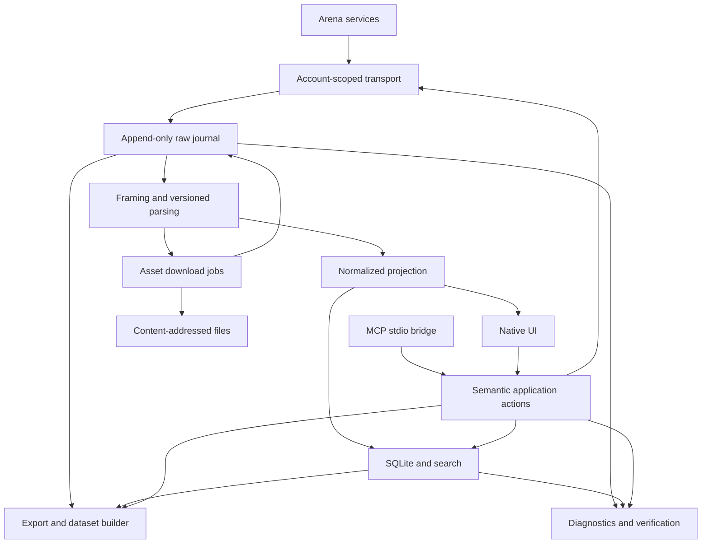

> **SUPERSEDED** by [`Arena-Suite-Master-Plan-v3.md`](Arena-Suite-Master-Plan-v3.md) on 2026-09-24. Kept for historical reference; where they conflict, v3 wins.

# Arena Suite — Implementation Plan

Architecture proposal • 20 September 2026 • **Master synthesis version 2.0**

This document specifies an implementation; it does not implement the application. The current brief is authoritative: Arena Suite is a native client that communicates directly with Arena. Earlier browser-runtime designs are not prerequisites.

**Recommendation:** build a Swift macOS application around an independently recoverable capture journal, a replaceable Arena protocol adapter, and a disposable SQLite projection. Prove native authentication and one complete conversation flow before investing in the full interface.

**Evidence terminology:** **Verified in repository** means inspected source or documentation from `musterm4nn-alt/arena-exporter`, not confirmation against today's Arena servers. **NEEDS PROTOCOL VERIFICATION** means a live, authorized experiment is required. **Design decision** means the architecture selected here. **Assumption** means a condition on which the recommendation depends.

No authenticated Arena session was exercised for this plan. No private endpoint is asserted to be a supported public API. Repository observations are research leads, not a service contract.

### What this master synthesis changes

This version keeps the v1 architecture as the authoritative backbone and incorporates only improvements that strengthen it without changing the product definition. In particular:

- **No production browser fallback is introduced.** A normal browser may be used as a Phase 0 research instrument to observe the user's authorized Arena traffic and create fixtures, but Arena Suite remains a direct native client. If native authentication or required application-protocol access cannot be achieved without a browser runtime, Phase 0 fails explicitly rather than silently turning the product into a browser bridge.
- **The durable-capture design remains authoritative.** The binary append-only journal is the source of evidence; SQLite and all semantic views remain rebuildable projections. No competing `state.sqlite` or second authoritative store is added.
- **UI, MCP, CLI/test harnesses share one semantic application service boundary.** UI code and MCP code do not each implement their own version of “send”, “stop”, “export”, “delete”, or “query”.
- **Dataset hygiene is elevated to a first-class archive concern.** Automation origin, label evidence, cross-lane continuation, harness/mode context, and other contamination-relevant facts are captured canonically so future model-attribution work does not have to guess them later.
- **Adversarial fixture testing is strengthened.** Parser chunk-split property tests, protocol mutation tests, subprocess crash/fault injection, registry-completeness tests, and deterministic export/leakage tests become release gates rather than optional hardening.
- **Account selection is presentation state, not transport ownership.** Switching the visible account never tears down an unrelated in-flight stream; work remains bound to the immutable account context captured when it began.
- **Compression stays optional and post-v1.** Do not assume Apple's `Compression.framework` provides Zstandard. If sealed-segment zstd is ever chosen, vendor/test a real zstd implementation; otherwise prefer a system-supported codec such as LZFSE. Active journals remain uncompressed.

## 1. Executive architecture

Use one native application process containing an `ArenaSuiteEngine` independent of the main actor. A small, separately launched stdio MCP executable connects to that engine through a local Unix-domain socket. The engine remains alive when its last window closes; explicit Quit ends it gracefully. Do not initially introduce a daemon, distributed service, or browser runtime.



The diagram compresses one important rule: outgoing commands, upload manifests, retries, cancellations, and relevant local observations also enter the journal. A prompt is recorded before dispatch. UI and MCP share the same action implementation; neither contains Arena endpoint logic.

Adopt these invariants:

1. **Record before interpret.** Preserve observed application payload bytes before UTF-8 decoding, JSON parsing, event interpretation, or rendering. Declare the credential exclusions described below.
2. **Raw capture is authoritative; projections are replaceable.** A parser upgrade creates a new projection generation, never an edited historical payload.
3. **A transport attempt is not a turn.** One user submission can cause multiple requests, streams, model lanes, tool steps, and failed attempts.
4. **Every action has an immutable account context.** Switching the visible account cannot redirect an existing task or change its attribution.
5. **Completeness is multidimensional.** A finished answer does not establish complete capture, known model identity, or successful file acquisition.
6. **No invisible loss.** Parser limits, storage failures, unsupported protocol constructs, and unobserved intervals become explicit evidence and warnings.
7. **Preserve observations, not speculation.** Display labels, requested models, and server-reported identities remain different claims.
8. **One semantic implementation.** Native UI, MCP, developer tools, and tests invoke the same typed application actions and query model; transport/endpoints never leak into those surfaces.
9. **Automation origin is evidence.** Every mutating command records its origin (`ui`, `mcp`, `developer_tool`, `recovery`, or future values), principal/client identity when applicable, and immutable command ID. MCP-originated turns can therefore be excluded from research datasets without heuristic reconstruction.
10. **Context lineage matters for attribution.** If one lane/model continues text selected from another lane, or a response inherits externally supplied context, record that lineage explicitly. Equal text does not imply equal authorship context.
11. **Account selection never rebinds work.** Switching the visible account changes new-command defaults only; active attempts, history jobs, downloads, exports, and streams retain their original account context until completion/cancellation.

The practical fidelity boundary is **the application-protocol data made available by the selected transport**. This captures original body bytes delivered to the app, stream framing within those bytes, exposed HTTP metadata, and WebSocket messages. It is not packet capture and does not expose the server's internal tokenization, hidden reasoning, TLS records, HTTP/2 wire frames, or data Arena never sends.

## 2. Recommended technology stack

| Area | Selection | Why; important alternatives |
|---|---|---|
| Platform | macOS 14.0 minimum, ARM64 only | A deliberate support floor, not a claim that 14 is current. The required architecture needs no newer-only API. Test on the user's current macOS as well. |
| Language/build | Swift 6 language mode, Swift 6.1+ compiler; full Xcode 16.3+; Xcode app target plus local SwiftPM packages | Strict concurrency checking, native signing and resource handling, independently testable engine. These are minimums for the proposed dependencies; pin one tested Xcode build and dependency revisions in CI. Command Line Tools alone are not the supported app-build environment. |
| UI | SwiftUI, Observation, AppKit bridges | `NavigationSplitView`, tables, settings scenes, inspectors; AppKit text views for selectable large transcripts and payloads. Reject Electron/Tauri: unnecessary browser runtime and weaker fit for this native-client brief. |
| Semantic app boundary | Typed `ApplicationService` / `ActionGateway` plus shared `ArchiveQuery` DTOs | UI, MCP, developer CLI/tests, and future automation call the same operations. Views never touch `URLSession`, the journal, or GRDB directly; MCP never reimplements business logic. |
| HTTP | Foundation `URLSession` with a data delegate and an explicit serial delegate queue | Native TLS, proxies, authentication integration, task metrics, mature cancellation. Do not use `AsyncBytes.lines` as the capture source: it obscures original callback and delimiter boundaries. |
| WebSocket | `URLSessionWebSocketTask`, only if observed | Records exposed binary/text messages, not raw fragmentation or ping/control frames hidden by the API. Require a different transport if those frames prove necessary. |
| Raw journal | Small documented binary record format using POSIX file I/O | Length-delimited metadata plus exact payload bytes, recovery checks, cheap append. Avoid JSON reserialization as raw storage and avoid a new database engine. |
| Index | SQLite through GRDB, WAL mode, FTS5 | Explicit schemas and migrations, transactions, prepared queries, observation. Prefer this over SwiftData/Core Data for replay, complex joins, auditability, and SQL maintenance. |
| Files/hash | Filesystem CAS; CryptoKit SHA-256 | Exact assets, deduplication, independent verification. SQLite stores references, not large file BLOBs. |
| Credentials | Security.framework Keychain | Per-account session material; avoid shared browser cookies and ordinary preferences files. |
| Timing | `mach_continuous_time`, `mach_timebase_info`, wall-clock anchors; `ContinuousClock` for scheduling | Persist integer ticks, clock identity, and conversion metadata. Never serialize a `ContinuousClock.Instant` as a portable timestamp. |
| MCP | Official Swift MCP SDK, stdio server in bundled executable | Standard tools/resources with a small integration layer. Local engine IPC is separate from MCP. |
| Logs | OSLog plus bounded structured JSONL diagnostics | Native operational visibility; portable support bundles. Transcript payloads belong in the archive, not logs. |
| Tests | Swift Testing and XCTest, local scripted HTTP/WebSocket fixture server, process fault harness | Unit/property tests plus actual process-crash and I/O failure tests. |

Foundation's data delegate and task metrics are the intended native observation points. Their values must be labeled as Foundation observations, not socket-level evidence. [Apple data delegate](https://developer.apple.com/documentation/foundation/urlsessiondatadelegate/urlsession(_:datatask:didreceive:)), [task metrics](https://developer.apple.com/documentation/foundation/urlsessiontaskmetrics), [WebSocket task](https://developer.apple.com/documentation/foundation/urlsessionwebsockettask).

**Transport alternative worth testing:** libcurl can disable content decoding and expose header callbacks, making it preferable if Phase 0 establishes that encoded entity bytes, duplicated headers, trailers, or WebSocket frame metadata contain needed information unavailable through Foundation. It adds C bridging, packaging, and a transport-dependent fingerprint. Start with Foundation, but make the capture acceptance matrix a release gate: replace the transport before production capture if it loses required application information. SwiftNIO/AsyncHTTPClient offers another interception point but introduces a larger networking stack. Neither alternative recreates the exact browser TLS/network fingerprint. [libcurl content decoding](https://curl.se/libcurl/c/CURLOPT_HTTP_CONTENT_DECODING.html), [header callback](https://curl.se/libcurl/c/CURLOPT_HEADERFUNCTION.html), [WebSocket receive](https://curl.se/libcurl/c/curl_ws_recv.html).

Project settings: `ARCHS=arm64`, deployment target 14.0, Swift 6 complete concurrency checking, Debug/Release configurations, Release optimization with symbols retained for local crash analysis. Use local development signing and a stable bundle identifier, for example `local.arenasuite.app`. App Sandbox is off initially because this is a private local app with a command-line bridge and user-selected archive paths; Hardened Runtime remains on where signing permits. Do not disable certificate verification or add broad ATS exceptions. No App Store distribution, notarization pipeline, updater, or Intel build in v1.

## 3. Arena communication strategy

### Evidence from the exporter

The inspected repository identifies itself as version 2.1.3. Useful findings:

| Inspected evidence | Architectural consequence |
|---|---|
| Main-world network interception recognizes Agent realtime traffic, evaluation streams, SSE/NDJSON, and Flight-like rows. | Do not assume one JSON-over-SSE protocol covers every Arena mode. |
| Request IDs and separate retry records were added to prevent late responses and rejected attempts from mixing. | Bind every request to an immutable account, command, attempt, and conversation context. |
| The session store limits retained evaluation data; some fallback paths truncate text. | Never copy its bounded raw-retention policy into the canonical journal. |
| Export documentation says parsed completed streams need not remain in raw form. | Keep successfully parsed raw data too; future parsers and timing studies need it. |
| Verification notes report incomplete recovery and model-label disagreement; a later change prefers visible labels in some cases. | Preserve each label claim and its source, time, and lane scope. Do not treat the latest visible label as proof for earlier responses. |

Sources: [interceptor](https://github.com/musterm4nn-alt/arena-exporter/blob/main/src/injected-main.js), [session store](https://github.com/musterm4nn-alt/arena-exporter/blob/main/src/session-store.js), [export schema](https://github.com/musterm4nn-alt/arena-exporter/blob/main/docs/export-schema.md), [verification notes](https://github.com/musterm4nn-alt/arena-exporter/blob/main/docs/verification.md), [changelog](https://github.com/musterm4nn-alt/arena-exporter/blob/main/CHANGELOG.md).

Observed source literals worth investigating are listed here solely as repository evidence:

| Repository pattern | Evidence status |
|---|---|
| `/api/history/unified`, fallback `/api/history/list` | In `history-backfill.js`; **NEEDS PROTOCOL VERIFICATION** for current behavior, pagination, authorization, and supported types. |
| `/api/evaluation/{uuid}` | In the same file; **NEEDS PROTOCOL VERIFICATION**. |
| `/ai-proxy/realtime/v1/sessions/<uuid>/out`, realtime session matching, input-append matching | In interceptor comments/matchers; **NEEDS PROTOCOL VERIFICATION**. |
| `create-evaluation`, `post-to-evaluation`, `create-chat` | Matched strings, not complete documented endpoint contracts. **NEEDS PROTOCOL VERIFICATION**. |
| `x-session-settled`, `x-stream-version`, `x-arena-chat-id` | Header names retained by the exporter; semantics and availability need verification. |

[History backfill source](https://github.com/musterm4nn-alt/arena-exporter/blob/main/src/history-backfill.js). Record the exact checkout commit in Phase 0. For this review, representative inspected blob hashes were `821354300eff2a76d5d963dd225118c5343517f4` for `injected-main.js`, `b120559e8e4134430791e1dd37d583d6fa3f8bf0` for `history-backfill.js`, and `f51f160abf0090df47d55099032f6fd2718c357c` for `session-store.js`. These are file blobs, not commit hashes.

### Feasibility research sequence

1. Observe an ordinary user-authorized browser session using developer network tools. Browser use here is a research instrument, not the production application architecture.
2. Capture the actual sequence for login, refresh, account identity, new conversation, send, completion, stop, history list, history detail, uploads, downloads, and model reveal. Save authorized private fixtures locally; check only sanitized fixtures into Git.
3. Build an endpoint ledger: observed URL/method, credential mechanism, CSRF requirements, request body grammar, content types, redirects, stream grammar, terminal signals, version hints, rate-limit behavior, and supporting fixture IDs.
4. Reproduce **one** flow in a native proof client using the user's legitimate credentials. Do not guess unobserved routes or replay a captured state-changing request indiscriminately.
5. Relaunch the proof client, refresh its session, load its prior conversation, continue it, and switch between two accounts. Confirm server identity before each account is accepted into the profile registry.
6. Compare native output with the same conversation retrieved in Arena. Compare lane IDs, message IDs, contents, exposed reasoning/tools, and files, not only rendered text.

**Stop/go gate:** if Arena requires nontransferable browser state, a browser-bound challenge on every generation, unavailable client registration, or a browser-only runtime to operate its consumer product, the requested direct native client is not yet proven feasible. Produce the observed blocker and retain the archive/protocol work. Do not quietly substitute a website wrapper or pretend that a public inference API implements consumer conversation history.

### Authentication and account isolation

**NEEDS PROTOCOL VERIFICATION:** login method, session cookies/bearer tokens, CSRF, refresh rotation, email links/OTP, OAuth callback availability, and challenge requirements.

Prefer a legitimate native-compatible email/OTP flow if observed. Use `ASWebAuthenticationSession` only if Arena actually supports a callback that the application can complete. It is not a general-purpose browser cookie extraction API. An authentication-only `WKWebView` is a conditional fallback for an observed compatible web login and cookie handoff; it must not become the chat client. If login occurs in a system browser without a supported handoff, do not promise session extraction. [ASWebAuthenticationSession](https://developer.apple.com/documentation/authenticationservices/aswebauthenticationsession).

Each local account has a UUID, verified Arena principal when exposed, Keychain credential reference, isolated cookie jar, credential generation, refresh coordinator, and its own freshly created ephemeral `URLSession` configuration. Use the configuration's private in-memory cookie store, never `HTTPCookieStorage.shared`; verify isolation on supported macOS versions. Set `urlCache` and `urlCredentialStorage` to nil. Let Foundation apply ordinary cookie domain/path/expiry rules within that account, and persist/restore that store's session material through Keychain. The adapter coordinates CSRF/refresh and credential stripping on redirects. Cookie identity/isolation tests are a gate; do not assume the word `ephemeral` proves correct application ownership or hand-roll cookie parsing from potentially merged header strings.

Allow one refresh flight per account. Refresh failure marks only that account as requiring reauthentication. Account switching changes UI selection, not transport objects. A task captures `AccountContext(accountID, principalID, credentialGeneration)` at creation. A response claiming a different principal is quarantined and shown as an identity mismatch. **Do not cancel or recreate account A's live stream merely because the user selects account B in the sidebar.** Per-account session coordinators live independently; UI selection only chooses the default context for the next action.

Never use multiple accounts to work around throttles or access restrictions. Honor `Retry-After` and per-account concurrency limits. Browser-only CAPTCHA/challenge state becomes `interaction_required`, with evidence retained; no automated bypass is part of this plan.

### Adapter contract and change policy

Expose capabilities such as `listHistory`, `continueConversation`, `stopRemoteGeneration`, `uploadAttachment`, `downloadWorkspace`, and `revealModels` as `supported`, `unsupported`, or `unknown`, each with evidence and last validation time. Modes and modalities are separate extensible strings: a code task is not automatically a distinct conversation mode.

Keep endpoint recipes, version hints, body encoders, stream dialect selection, file resolution, and history pagination inside `ArenaAdapter`. Use response media type and observed protocol metadata to select parsers; record heuristic selections as heuristic. A route regex alone is not protocol identification.

On drift, continue recording safe in-flight traffic even if interpretation fails. Mark the adapter degraded and disable further state-changing operations whose request contract is uncertain. Preserve read-only archive access. Ship adapter/parser updates with the app initially; do not build downloaded executable plugins or have an LLM generate and run replacement parsers automatically.

## 4. Capture pipeline

### Record types and envelope

Distinguish local observations, transport observations, and derived records. Suggested raw kinds include `command.accepted`, `request.prepared`, `request.resume_called`, `response.headers`, `response.body_chunk`, `websocket.message`, `transport.metrics`, `transport.failed`, `transport.closed`, `ui.presentation_observed`, `asset.acquisition`, `history.fetch`, and `recovery.observation`.

An illustrative envelope follows. These are Arena Suite fields, not invented Arena payload fields. JSON examples use strings for potentially large integers to avoid JavaScript precision loss.

```json
{
  "envelope_version": 1,
  "event_id": "local-event-uuid",
  "capture_session_id": "local-capture-uuid",
  "account_id": "local-account-uuid",
  "record_seq": "418",
  "request_attempt_id": "local-attempt-uuid",
  "stream_id": "local-stream-uuid",
  "stream_seq": "27",
  "command_id": "local-command-uuid",
  "kind": "response.body_chunk",
  "direction": "inbound",
  "origin": "live",
  "observed_at_utc": "2026-09-20T12:00:00.123456Z",
  "clock": {
    "clock_session_id": "local-clock-uuid",
    "monotonic_ticks": "318142310095",
    "timebase_numer": 1,
    "timebase_denom": 1,
    "wall_anchor_id": "anchor-uuid"
  },
  "observation_layer": "urlsession_body_callback",
  "transport_fingerprint": "foundation-profile-v1",
  "payload": {
    "storage": "inline_record_bytes",
    "length": 284,
    "sha256": "64-lowercase-hex-digits",
    "representation": "foundation_delivered_entity_bytes",
    "body_offset": "6144"
  },
  "transformations": [],
  "remote_id_hints": {},
  "previous_record_hash": "64-lowercase-hex-digits"
}
```

The actual record contains the payload bytes after the envelope; they are not decoded and re-encoded into this JSON. Remote IDs may be unknown at capture time. Later association records connect a request to conversations/turns without editing the original envelope. A parser version belongs to a derived event, not to an unparsed raw observation. Preserve adapter and transport build versions in the capture-session manifest.

### Binary format

Use `ASJ1` magic, fixed-endian record length, envelope length, payload length, UTF-8 envelope bytes, binary payload, and a SHA-256 record digest/trailer. Fix widths in `journal-format-v1.md`, cap envelope size, validate all lengths with overflow checks, and use SHA-256 over a domain separator, previous digest, lengths, stored envelope bytes, and payload bytes. The first record of a segment references the previous sealed segment digest.

Hash the **stored bytes**, not a JSON object reconstructed later. Digest chains detect damage or missing/reordered local records when compared with a trusted manifest; they are not proof against someone rewriting the entire local archive. Keep per-payload hashes for extracts and asset references.

Use an uncompressed active segment, rotating at approximately 64 MiB or orderly shutdown. Large observed callbacks can be fragmented into storage records without inventing additional network chunks: preserve one `observation_unit_id`, original length, common observation timestamp, fragment offsets, and fragment count. Parser frame limits restrict interpretation, never discard recorded bytes. Oversized frames spill parser state to a temporary file or become unsupported with an exact raw span.

### Ordering and persistence

One `CaptureWriter` on a dedicated serial queue owns all journal descriptors. Each account capture session has its own ordered journal, `record_seq`, and predecessor manifest. All streams in that session share the journal sequence; every stream also has its own sequence and body byte offset. Across accounts there is no meaningful global server order. Queries use a stable total display order based on capture metadata and IDs, without claiming causal ordering.

The callback samples the clock immediately and synchronously hands a small header plus `Data` to the capture writer. The writer completes all partial `write` calls before acknowledging append. Only then does it publish a durable-location reference to downstream consumers. Do not create an unbounded `Task` for each callback or depend on actor task scheduling to preserve arrival order.

Use these distinct watermarks:

| Watermark | Meaning |
|---|---|
| Observed | Callback began and a timestamp was taken; not yet a preservation guarantee. |
| Appended | A complete valid record was written to the OS; survives ordinary process termination, subject to OS/filesystem correctness. |
| Synchronized | A successful explicit file synchronization covered the record. |
| Projected | The selected parser/index generation processed the record. |

Default sync policy: sync accepted user commands before dispatch, batch stream syncs on a 100 ms target interval or 1 MiB of new data, and sync terminal/error/segment-seal records. This interval is a target, not a maximum power-loss bound. Offer a high-durability setting with more frequent `fsync`/macOS full-sync where supported and measured. A process crash and sudden power loss have different guarantees; label them honestly.

### Framing and unknown information

Frame parsers consume journal ranges, maintaining offsets into original bytes. Preserve SSE comments, line endings, `event`, `id`, `retry`, repeated data fields, empty fields, BOM handling, incomplete tails, and unknown fields. A frame may span multiple callbacks; one callback may contain many frames. Maintain the mapping in both directions. Follow the standard framing rules rather than splitting on `\n\n` alone. [WHATWG SSE specification](https://html.spec.whatwg.org/multipage/server-sent-events.html).

For NDJSON, Flight-like records, and other observed dialects, retain the complete byte stream and use a separately versioned grammar. Do not assume every colon-prefixed line is valid Flight. Opaque/binary messages survive even when no decoder exists. WebSocket strings are labeled as transport-delivered text messages, not exact original frame bytes; binary messages retain their `Data` bytes.

Unknown event types yield `UnknownProtocolEvent` with raw span, observed type, stream identity, parser version, and warning. Unknown JSON fields remain recoverable from raw and are indexed by JSON pointer and structural type where useful. Preserve duplicate JSON keys and large numeric lexemes in raw even if a normalized decoder cannot represent them. A schema decoder must not silently coerce them to ordinary Swift `Double` values and present the result as exact.

### Credentials and fidelity exceptions

Do not apply the extension's broad text-redaction regexes to all canonical model output. They can destroy legitimate evidence. Instead:

- Credential injection happens after construction of the archived request description. Header names and redaction reasons are recorded; passwords, Cookie/Authorization values, CSRF secrets, CAPTCHA solutions, and authentication-only response bodies are intentionally omitted from ordinary evidence. Active session material goes to Keychain.
- Record an explicit `credential_omitted` transformation with scope and policy version. A sanitized request is not described as replayable or byte-identical to the authenticated wire request.
- Preserve ordinary conversation protocol bodies exactly, including unknown fields. Treat opaque bodies as potentially sensitive for export and diagnostics. If a later parser discovers embedded credentials, add a sensitivity annotation and export rule; do not silently edit old raw evidence.
- Default diagnostics contain no raw bodies. Default exports apply a versioned redaction policy to credential-bearing structures. Unsupported opaque data that cannot be safely inspected is referenced and omitted from the default portable export with a reason; an explicit evidence export can include it. Never claim a heuristic secret scan guarantees that arbitrary user text or files contain no secrets.

This is a narrow, declared exception to exact capture for reusable authentication secrets. It avoids a second encrypted credential archive and associated key-recovery complexity. If exact authentication-forensics capture is later requested, add an explicit restricted evidence mode rather than weakening the ordinary export contract.

### Crash recovery

On launch acquire an exclusive archive lock, read supported format versions, and scan only unsealed tails plus unindexed sealed segments. Validate record lengths, trailer hashes, sequence continuity, and referenced payloads. Keep every valid prefix record. Copy/quarantine torn tail bytes before repair; never silently truncate a sealed segment or skip corruption in its middle.

Create a new segment containing a recovery observation with the previous valid high-water mark. Any previously active attempt lacking a terminal record becomes `interrupted/process_exit`; do not manufacture a server completion. Replay from the last transactionally committed projection checkpoint. If there was a sent-but-unacknowledged generation request, its remote outcome is unknown: reconcile history before offering a new submission. Do not automatically resend it.

## 5. Normalized data model

Use stable local UUIDs or deterministic domain-separated IDs. Treat all remote identifiers as opaque strings. A remote ID is qualified by account, provider namespace, entity kind, and any verified parent scope; never assume global uniqueness or UUID syntax.

| Entity | Required meaning and core fields |
|---|---|
| Account | Local ID, display name, principal claims, Keychain reference, creation time, auth state; no raw secrets. |
| Conversation | Local ID, account, remote references, observed mode/modality, titles with revisions, created/updated observations, remote-deletion state. |
| Branch | Local ID, conversation, parent branch/fork message, remote branch identifier if exposed; otherwise explicit inferred/local-only status. |
| Turn | One logical user submission and its parent context; conversation, branch, command ID, triggering user message, lifecycle, action origin/principal, and context-lineage classification. |
| RequestAttempt | An actual outbound attempt, retry predecessor, account context, endpoint recipe, result, network requests/streams. |
| ResponseLane | A/B or other remote lane key, turn, selected-model claims, answer message lineage, and `context_source` such as `fresh`, `self`, `cross_lane`, `imported`, or `unknown`. Support more than two without redesign. |
| Message | Local ID, role, conversation, turn/lane when known, parent message, remote identifiers, revisions, source kind. |
| ContentBlock | Ordered text/code/image/audio/file/reasoning/tool-reference/opaque block; original block ID, block kind, revisions, raw spans. |
| ReasoningSpan | Exposed reasoning block/segment, visibility classification, start/end observations, text reference, terminal status. Do not infer missing reasoning from silence. |
| ToolCall | Local ID, remote tool-call ID, name, parent call, lane/step, argument fragments, parsed arguments if valid, lifecycle. |
| ToolResult | Zero or more results for a call, status, content blocks, raw references, associated files. A result can precede call discovery. |
| File/Asset | Immutable byte object plus acquisition records and many associations; filename and Arena resource IDs belong to associations, not the hash alone. |
| CaptureEvent | Raw record location, event ID, timing, sequence, kind, stream and request linkage. |
| ParsedEvent | Derived type, decoder version, source spans, normalized interpretation, unknown-field observations. |
| TimingObservation | Named clock event, original tick/wall stamp, observation layer, source event, subject and lane. |
| TimingMetric | Versioned formula, input observations, numeric result/unit, missingness, exclusions, confidence/quality. |
| Error | Stage, domain/code, account/request/job linkage, first/last occurrence, retryability, source evidence. |
| IdentityClaim | Claimed model/harness/reasoning level, subject scope, source, validity interval, evidence, confidence class. |
| CompletenessAssessment | Coverage vector, warnings and supporting evidence; produced by a versioned evaluator. |
| ProvenanceReference | Owner entity/field, raw event/span or historical snapshot, derivation rule, parser version. |

Model identity classes: `arena_reported`, `requested_selection`, `catalog_display`, `page_display`, `user_annotation`, `inferred`, `unknown`. `arena_reported` means Arena made the claim; it is not independent verification of its serving backend. Store orchestrator, lane responder, tool model, model family, alias, and reasoning-level claims separately. Do not upgrade an identity merely because a field is named `model`.

Messages are a graph, not a list obtained by alternating user/assistant roles. Preserve edits, regenerations, parallel answers, branch parents, replacement snapshots, and missing ancestors. Do not merge messages because their text is equal. Separate raw delivery duplication from repeated content deliberately generated by a model.

For values, distinguish `known`, `not_exposed`, `not_captured`, `not_applicable`, `parse_failed`, `redacted`, and `unknown`. SQLite can use a nullable value plus `value_state`; public JSON should encode both. Empty text, zero milliseconds, and false are legitimate known values, not missingness sentinels.

Recommended completeness dimensions:

```json
{
  "source_coverage": "live_from_request_start",
  "transport": "terminal_observed",
  "raw_capture": "continuous_at_observation_boundary",
  "semantic_parse": "unknown_events_present",
  "history": "not_applicable",
  "assets": "one_unavailable",
  "identity": "not_exposed",
  "warnings": ["unknown_event_type", "asset_url_expired"],
  "assessment_version": 1
}
```

UI summaries derive from this vector: “Live captured · unknown events · 1 file unavailable,” “Historical snapshot · pagination incomplete,” or “Live capture interrupted.” Unknown model identity alone is not a transcript capture failure. “Complete” always names its scope; it never means complete server-side telemetry.

## 6. SQLite schema

Use `archive.sqlite` as a rebuildable projection. Tables contain normalized query data, locations, and current operational projections; authoritative local edits such as tags, settings, and deletion intent also have journal records. Recovery must not lose them by rebuilding the database.

All normalization-owned tables carry `generation_id` directly or through an unambiguous parent; use `(generation_id, id)` keys and matching composite foreign keys for versioned entities. Raw-event locators, capture sessions, physical asset objects, and stable account identities are shared catalogs rather than duplicated per parser generation. Prefer account-qualified foreign keys where needed. UUIDs can be 16-byte BLOBs internally; remote IDs are TEXT. Nanoseconds/ticks use checked 64-bit storage and explicit clock metadata. Store UTC epoch microseconds as INTEGER for range filters, preserving original precision separately.

| Tables | Important columns and constraints |
|---|---|
| `accounts` | `id PK`, display_name, principal_id nullable, credential_ref, auth_state, deleted_at. Principal uniqueness only after provider semantics are verified. |
| `capture_sessions` | `id PK`, account_id FK, predecessor_id, opened_at, clock_session_id, transport_build, app_build, close_state. |
| `journal_segments` | session_id, ordinal, relative_path, byte_size, sealed, first_seq, last_seq, hash, prior_hash; unique(session_id, ordinal). |
| `raw_events` | event_id PK, session_id, record_seq, stream_seq, segment_id, offset, length, payload_hash, kind, attempt_id, observed_utc_us, ticks; unique(session_id, record_seq). |
| `commands` / `request_attempts` / `streams` | local IDs, account/conversation context, idempotency key, parent command, retry_of, method/route classification, status, result state, terminal evidence. |
| `entity_remote_ids` | account_id, namespace, entity_kind, parent_scope, remote_id, local_entity_id, evidence_event_id. Use a scoped unique constraint, not remote_id alone. |
| `conversations` / `conversation_revisions` | IDs, account, mode, modality, current revision, remote deletion observation; append revision rows with source references. |
| `branches` / `turns` / `response_lanes` | conversation/parent references, stable lane key, attempt links, lifecycle. `turn_attempts` handles multi-request turns. |
| `messages` / `message_revisions` / `message_edges` | role, parent/branch/lane, revision text projection, source event; edges identify continuation, regeneration, replacement, and fork relationships. |
| `content_blocks` / `block_revisions` | message revision, stable block key, ordinal, type, text or asset reference, structured known fields. Unique(message_revision_id, ordinal). |
| `reasoning_spans` / `tool_calls` / `tool_results` | block/lane/step links, argument/result state, timing references; remote call IDs qualified by verified stream/turn scope. |
| `model_claims` / `model_catalog_snapshots` | subject kind/id, claim role/value/source, observed time, validity scope, evidence; retain conflicting claims. |
| `assets` | sha256 PK, relative_path, byte_count, verification_state; immutable bytes. |
| `asset_acquisitions` / `asset_links` | job, source event, account, remote file ID, original filename/MIME, redirects/source refs, status; many links to one asset hash. |
| `parsed_events` / `raw_span_refs` | parser build/generation, derived ordinal, type, event linkage, byte spans. Frame mapping may reference several raw records. |
| `field_provenance` / `unknown_fields` | entity/field path, source event/span, rule; unknown JSON pointer, type, counts, first/last sample references. |
| `timing_observations` / `timing_metrics` | subject/lane, clock/event name, ticks, value_state; formula_version, inputs, value, unit, quality. |
| `capture_assessments` / `capture_warnings` / `errors` | scope, dimension/status, codes, evidence, evaluator version, resolution. |
| `history_runs` / `history_pages` | account, adapter version, cursor before/after, raw response event, fetch result, high-water snapshot, exhaustion status. |
| `tags` / `entity_tags` | stable local metadata replayed from commands. |
| `projection_generations` / `projection_checkpoints` | parser/config hashes, source high-water marks, build state, activated time, per-session committed position. |
| `jobs` / `job_attempts` / `export_runs` | resumable state, input snapshot, permissions principal, cancellation, output manifest hashes, error. |
| `settings_projection` / `permission_profiles` / `mcp_clients` | versioned local configuration projections; secret refs only. |

Indexes to create initially:

- Conversations `(account_id, updated_utc_us DESC, id)`; remote ID lookup via `entity_remote_ids`.
- Turns `(conversation_id, branch_id, ordinal)` and lanes `(turn_id, lane_key)`.
- Messages `(conversation_id, turn_id)`; tool calls `(tool_name, turn_id)`; asset links `(conversation_id, turn_id)`.
- Raw events `(session_id, record_seq)`, `(attempt_id, record_seq)`, `(kind, observed_utc_us)`; unique stream sequence within its stream where assigned.
- Timing metrics `(metric_name, value, turn_id)` plus formula/quality filters; assessments `(dimension, status, conversation_id)`.
- Model claims `(claim_value, claim_source, subject_id)`; tags `(tag_id, entity_id)`.
- FTS5 over searchable message/turn text with role, account, and conversation filters joined through regular tables. Treat its tokenizer output as search data, never model tokens.

Use foreign keys on every connection, WAL, a short configurable busy timeout (start at 2 seconds), and a GRDB `DatabasePool` with one writer and bounded readers. Start `synchronous=NORMAL` for this rebuildable projection; journal durability is separate. Checkpoints belong to the same transaction as their projected rows. SQLite documents the durability tradeoff and WAL reader/checkpoint behavior. [WAL](https://www.sqlite.org/wal.html), [synchronous pragma](https://www.sqlite.org/pragma.html#pragma_synchronous), [GRDB](https://github.com/groue/GRDB.swift).

Do not copy raw bodies, all headers, asset bytes, or each text delta into additional full SQLite BLOBs. Store raw locations and assembled searchable text. Known small structured fields may be duplicated intentionally for queries. Explain every such duplication in the schema documentation.

Migrations update the index transactionally after a consistent backup. If a new projection cannot migrate safely, rebuild alongside the old database, catch up to a captured high-water mark, validate, then switch generations atomically. Never hold a database transaction across networking. Long exports copy the required snapshot metadata and release read transactions to avoid indefinite WAL growth.

## 7. Filesystem/archive layout

Default archive root: `~/Library/Application Support/Arena Suite/Archive/`. Resolve it using system directory APIs, not a hardcoded home path. Support moving it while capture is stopped; verify the new root before switching. Start with a local APFS volume. Network filesystems and cloud-synchronized live databases are unsupported initially.

```text
Archive/
  archive.json
  accounts/
    <account-id>/
      profile.json
      captures/
        <capture-session-id>/
          session.json
          segments/
            000001.asj
            000001.seal.json
            000002.open.asj
      conversations/
        <conversation-id>/
          manifest.json
          snapshots/
            <generation-id>-<high-water-hash>.json
  control/
    <control-session-id>/
      000001.asj
  objects/
    sha256/
      <first-two-hex>/
        <full-sha256>
  staging/
    downloads/<job-id>.partial
    uploads/<job-id>.partial
    projections/<generation-id>/
    exports/<job-id>/
  index/
    archive.sqlite
    archive.sqlite-wal
    archive.sqlite-shm
  derived/
    parser-runs/<generation-id>/manifest.json
    datasets/<dataset-id>/
  diagnostics/
    bundles/<bundle-id>/
  recovery/
    quarantined/<incident-id>/
  trash/
    <deletion-id>/
  runtime/
    owner.lock
```

Use an OS-provided per-user runtime directory for the MCP Unix socket if the archive path would exceed socket path-length limits. Logs belong in `~/Library/Logs/Arena Suite/`, with size and age rotation, not in raw evidence segments.

`archive.json` identifies the archive UUID, raw-format versions, creation details, and feature flags. Account/profile and conversation manifests are atomically written **derived navigation aids**. They reference capture sessions/events and asset hashes; journal records remain sufficient to reconstruct them. Never name authoritative objects by a mutable conversation title. Generated files can expose friendly names through manifests and Finder export; originals remain hash-named.

Save an automatic normalized snapshot after a turn settles and after a history ingestion batch. It is a versioned derived convenience, not the raw archive and not the only surviving copy. A stalled snapshot writer must not delay capture.

No compression of active journals in v1. Add optional sealed-segment compression later only with transparent restoration of original bytes, recorded codec/version, uncompressed checksum, seek/index support, and a safe migration. Original assets stay exact; do not transcode or recompress them to save space.

Maintain distinct versions for raw envelopes/container, normalized schema, SQLite migrations, adapter, framing parser, normalizer, timing formulas, completeness evaluator, exporter, and dataset recipe. A global app version is not a replacement for these.

A raw-format upgrade appends new-version segments while retaining old readers and original bytes. Never migrate old raw records in place. A required relocation/compression/conversion uses a recorded source/destination manifest and verifies hashes before the old representation is retired by explicit policy. An older app encountering an unsupported format opens only the portions it can safely read and refuses mutation; it must not “repair” an unfamiliar format.

Keep each released parser's source commit, dependency lock, configuration, and build metadata available with the release artifacts. Replay uses captured catalog/configuration snapshots, not today's Arena catalog, current wall time, or network lookups. A build hash alone does not guarantee that the executable needed to reproduce it will remain available.

For backups, seal/rotate at a boundary, snapshot a manifest/high-water mark, copy immutable referenced journals/objects, and use SQLite's backup API if including its cache. A casual copy of a live `.sqlite` file without its WAL is not a database backup. Credential Keychain state is intentionally separate; archive restoration can remain usable offline after reauthentication. [SQLite backup API](https://www.sqlite.org/backup.html).

Deletion is an explicit maintenance operation: soft-delete/hide first; permanent removal must follow raw references, shared-asset reachability, and local control events. Per-account journal placement makes account deletion straightforward. Purging one conversation from a session containing others requires an explicit survivor-rewrite/compaction operation with a migration manifest; do not pretend deleting its derived folder removes its evidence. Append-only means no silent edits, not that user-authorized deletion is impossible.

## 8. Timing system

Sample a monotonic tick and wall time as close together as possible at application startup, capture-session start, and periodically thereafter. Include timebase numerator/denominator, clock-session ID, estimated sampling uncertainty, app/transport build, and sleep/wake observations. Use `mach_continuous_time` for elapsed measurements including sleep; derive optional awake-only intervals using separately recorded sleep ranges. Never silently subtract sleep from the primary elapsed metric. [Apple monotonic clock API](https://developer.apple.com/documentation/kernel/1646199-mach_continuous_time).

Persist original ticks. Convert with checked integer arithmetic; avoid floating-point nanosecond timestamps. Wall-clock changes create new anchors. Server timestamps are retained as server claims with their own clock domain. They are not directly subtracted from the client's monotonic clock.

| Observation | Exact boundary |
|---|---|
| `send_interaction` | Native Send action/keyboard command begins, before validation. For MCP, record `command_received` instead; do not invent a click. |
| `command_accepted` | Input validated and command ID allocated; acceptance journal record written. |
| `request_resume_called` | Immediately before `URLSessionTask.resume()`. This is a dispatch proxy, not a proven socket write time. |
| `request_start_metric` | Foundation's request-start metric when available; preserve its reported wall-clock representation and uncertainty. |
| `response_headers_callback` | First response metadata callback for the relevant attempt; record redirects separately. |
| `response_start_metric` | Foundation's reported response-start time when available. Retain it as a transport metric; the header callback remains the directly sampled monotonic observation. |
| `body_callback_begin` | First and every subsequent body callback, before append/parse. |
| `first_frame_complete` | Arrival time of the byte that completes the first stream frame, derived from raw span-to-callback mapping. |
| `first_semantic_response` | First complete parsable event with meaningful answer/reasoning/tool data, excluding heartbeats and bookkeeping. |
| `first_answer_chunk` | First event contributing nonempty answer text to the specific response lane. Also derive a non-whitespace variant if useful. |
| `first_reasoning_chunk` | First exposed reasoning content; separate from an explicit `reasoning_start` marker. |
| `reasoning_start/end_marker` | Explicit protocol marker arrival, if one exists. No end marker means no measured true reasoning-end time. |
| `tool_call_announced` | First event identifying a tool call; arguments may still be streaming. |
| `tool_arguments_complete` | Observed completed argument event or a verified completion rule. |
| `tool_execution_started` | Only when the protocol explicitly exposes this transition. |
| `tool_result_first/final` | First result data and explicit final-result observation, respectively. |
| `answer_last_content` | Last content-contributing event presently known for the lane; may change if later evidence arrives. |
| `generation_terminal` | Logical model/lane completion marker, with finish reason and source event. |
| `turn_terminal` | All expected lanes/steps reach a verified terminal condition, or an explicit turn-complete record arrives. |
| `transport_closed` | Physical request/stream termination; long-lived transports may remain open after a turn completes. |
| `ui_update_committed` | Native transcript update committed on the main thread for a visible window; an approximation of display, not photons reaching the screen. |

Record enqueue, append-complete, sync-complete, parse-complete, index-commit, and UI-delivery times separately. A frame decoded later retains its original arrival-derived time. Multiple frames completed by one callback can legitimately share one timestamp; do not synthesize sub-callback precision.

**TTFT convention:** reserve `ttft_token` for a protocol exposing defensible actual token boundaries. In ordinary chunk streaming, display **Time to first answer chunk**:

`TTFAC = first_answer_chunk.arrival - request_resume_called`.

Also calculate `send_to_first_answer_chunk` and `time_to_first_semantic_response`. For reasoning-first models, these intentionally differ. For two lanes, produce lane-specific values. For reconnects, distinguish original command-to-first-output from attempt-to-first-output. A history-only response has no live TTFAC.

Other defensible metrics:

- Response-header latency, first-body latency, frame arrival delays, and content-delta arrival distributions.
- Observed reasoning span, using explicit marker pairs when present; otherwise a separately named first-to-last reasoning-content span. Neither is the server's actual compute duration.
- Tool round-trip from complete arguments to final result, or announced-call to final result if that is all that is available; formula identity records which definition was used.
- Tool gaps and overlaps, within a declared lane/step. Never interpret concurrent tools as one serial chain.
- Generation-terminal minus first-answer-chunk, total turn elapsed, and physical stream lifetime.
- UTF-8 bytes/second and Unicode-scalar additions/second over an explicitly named interval. Text replacement events and snapshots must not inflate delta counts.
- Provider-reported output-token count divided by a documented interval, only if that count and scope are exposed. Estimated tokenizer counts require tokenizer name/version and an `estimated` label.

Return unavailable states for absent markers, invalid clock comparisons, and zero-length denominators. Record incomplete intervals with an end-censored flag, not a fabricated end time.

For future fingerprinting, preserve burst sizes, heartbeat rhythm, inter-delta quantiles, early reasoning/answer transitions, tool sequencing, stalls, retry counts, transport protocol, connection reuse, compression representation, and observed queueing/parse/UI lag. Also retain mode, harness, selected configuration, app/adapter version, network-path class, and sleep/thermal/power observations when accessible. These features can identify the **client, network, or Arena harness** instead of the underlying model; dataset construction must control for that confounding.

## 9. Native UI architecture

Use conventional macOS windows, menu commands, resizable split views, searchable tables, inspectors, selectable text, and system appearance. SwiftUI owns navigation/state presentation; AppKit is a targeted bridge for large text and file dialogs. System controls should adopt the running OS appearance without recreating glass effects manually. These are implementation recommendations, not a claim that a rendered UI has undergone HIG validation.

| Surface | Specification |
|---|---|
| Main sidebar | Persistent destinations: Arena, Archive, Files, Diagnostics. Account switcher at the top with account name and authentication state. Recent conversations below the active destination. |
| Arena conversation | Native transcript, one or several labeled response lanes, composer, attachment picker, mode/configuration controls derived from capabilities, Send and Stop. Exposed reasoning and tool events are expandable sections. |
| Account switcher | List profiles, add account, authenticate, rename local profile, sign out, remove profile. Show active jobs per account. Switching preserves existing streams and unsent drafts per conversation. |
| Archive browser | Search bar, filter builder, sortable table, saved filters. Columns include account, date, title/ID, mode, model claim, tool count, files, completeness, TTFAC, total duration, and live/historical source. |
| Turn inspector | Tabs: Transcript, Normalized, Raw Events, Timeline, Tools, Files, IDs/Provenance, Warnings. A raw event opens headers/body bytes, hex/text views, frame boundaries, and source references. |
| Diagnostics window | Capture status, active streams, journal/index lag, unknown events/fields, parser errors, failed assets, auth state, checks, disk status, MCP requests. Filter by account/request/turn. |
| Settings | Accounts; Archive; Capture/durability; Export; MCP clients/permissions; Diagnostics retention; Advanced adapter/compatibility information. |

The conversation toolbar always contains an adjacent **format picker** and **Export Conversation** button. Formats: Raw JSON, Normalized JSON, Markdown, Training JSONL. Persist the chosen format in local settings. Add distinct **Download Last Response** and **Open Archive Folder** controls. Use Downloads by default through system directory lookup; a split-button option opens `NSSavePanel` for another destination. Respect cancellation. Reveal folders with `NSWorkspace`.

For multiple model lanes, “Last Response” uses the explicitly selected lane; if none is selected, show a small lane chooser. Do not silently pick A or merge two answers. The label should identify the selected response. During generation, exporting is allowed but the export identifies its source high-water mark and partial status. Latest means latest eligible message on the selected branch, not whichever event arrived last globally.

Show three separate states near the transcript: generation state, archive state, and interpretation warnings. For example: “Generating,” “Saved through event 418,” and “2 unknown events.” A response may render normally while the warning remains visible. Historical views display “Historical retrieval” with unavailable timing values; never fill timing cells with zero.

Selecting an archived conversation works offline. “Continue in Arena” is available only if the account is authenticated and the adapter has a verified continuation path. If Arena deleted it or no longer permits continuation, retain the archive and offer a new conversation with deliberately selected context; do not claim restoration of the original server thread.

Archive filters must expose model **claim source**, timing metric definition/quality, completeness dimensions, action origin, and context-lineage state, not just a simplistic green/red badge. Content search can include or exclude reasoning/tool text. Query results are paged, cancelable, and accompanied by projection lag when relevant.

Define the filter model as a serializable, versioned `ArchiveQuery` type shared by the native archive browser, MCP, developer tools, exports, and dataset recipes. A query constructed in the UI must be reproducible headlessly without translating it into a second ad-hoc filter language. Keep presentation-only columns/sort state separate from the semantic selection.

Accessibility and behavior: complete keyboard navigation, standard copy/select-all, Command-F search, Command-N new conversation, Command-Comma settings, accessible tooltips and labels, semantic warning text in addition to color, adjustable text, Reduce Motion support, and VoiceOver summaries. Automatically scrolling every token must stop when the user scrolls upward. Coalesce visual updates to roughly 20–30 Hz; raw events remain uncoalesced.

## 10. Historical conversation ingestion

History ingestion uses the same recorded transport as live chat. It archives the **current retrieval responses**; it does not recreate original streams.

Implement a resumable `HistoryIngestionJob`:

1. Freeze account context and verify identity. Record job configuration, adapter version, requested date/scope, and start time.
2. Fetch an observed history-list page. Journal the request and response before parsing.
3. Record its cursor, entries, ordering, pagination claims, and source timestamp. Fetch details and any exposed branches/attachments using verified routes.
4. Commit the page's normalized results and checkpoint together. A page can safely be fetched again after interruption because snapshots and acquisitions have stable content/source identities.
5. Follow the server's supplied continuation mechanism. Detect repeated cursors, repeated page hashes, inconsistent totals, and a missing cursor when the server says more data exists.
6. Finish with an explicit manifest of pages, item IDs, failures, gaps, and the observed exhaustion evidence. Stop/Resume operate at recorded page boundaries.

**NEEDS PROTOCOL VERIFICATION:** whether listing is stable while new conversations are created, whether cursors expire, whether archived/deleted threads are listed, and whether all branches/tool data require separate requests. Until known, label a full-history sync as “completed observed pagination” rather than a guaranteed globally consistent snapshot. Use overlapping refreshes and identifier deduplication to reduce moving-list gaps.

Historical messages carry separate `source_created_at` and `retrieved_at`. Exposed server times retain their precision and meaning. Original chunk boundaries, inter-token delays, TTFT, network errors, and transient tool events are `not_captured`/`not_exposed` unless actually present in a stored historical resource. A reported aggregate duration can be retained as server-reported metadata, never relabeled as a live measurement.

Store each fetched snapshot as immutable evidence even if later snapshots disagree. Use source revisions/ETags when exposed; otherwise hash the response. Merge by scoped IDs and relationships. If IDs are absent, create source-local entities and propose an uncertain association; never merge solely by prompt text and time proximity.

When a historical snapshot overlaps a live record, retain both. A field may prefer an explicit live observation for timing and a later server revision for edited text; the preference rule is versioned and visible. Mark conflicts instead of overwriting them. A remote 404 is an observation of absence/access failure, not automatic permission to delete the local archive.

If Arena provides only a server-rendered page/Flight snapshot for a needed history field, the adapter may retrieve and parse those bytes directly with a versioned parser. Do not implement a general React renderer or rely on a guessed pagination route. An inaccessible remainder yields `historical_partial` with an actionable reason.

## 11. File capture

Treat **byte objects**, **remote resources**, and **file appearances** as separate entities. One hash can have different filenames and many conversation/tool links. A stable remote file ID can later resolve to different bytes; retain both acquisitions.

Uploads:

1. Copy the selected file into same-volume staging, stream its SHA-256, and record original filename, MIME claim, size, and acquisition time.
2. Complete and commit the CAS object before uploading. Read the upload from the archived snapshot so later source-file edits cannot change what is sent.
3. Journal request composition. For multipart data, retain the exact generated boundary, ordered headers, text fields, and CAS byte spans sufficient to reconstruct the composed entity. A streaming tee records emitted byte counts/offsets and retry attempts. Do not falsely claim to observe TLS or HTTP transfer framing.
4. Associate returned Arena resource IDs with the upload attempt, turn, message, and raw evidence. Failed uploads remain archived locally with an explicit result.

Downloads:

- Schedule as soon as an exposed resource is discovered, prioritizing expiring signed URLs. Use a separate concurrency pool, initially two downloads and one history scan per account; configurable limits must honor server behavior.
- Download to `.partial`, hash incrementally, record HTTP metadata and redirects, expected versus actual length, source credential context, and each attempt. Large download bytes can be held in a referenced append-only staging object instead of being duplicated in the event journal. Sync byte ranges before journaling a receipt claiming that range exists.
- Resume only when verified range support and a strong representation validator justify it. Validate 206/Content-Range and If-Range semantics. If the object changed, start a new acquisition rather than appending mismatched bytes.
- On success synchronize, atomically rename on the same filesystem into `objects/sha256`, verify an already-existing object before deduplication, then append `asset.committed`. A crash after rename but before the event leaves a discoverable orphan, not a missing referenced file.
- Use checksums supplied by the service only with their stated algorithm/meaning. ETag is not assumed to be MD5. A locally computed hash proves local byte identity, not that the server intended those bytes.

Retry safe GET downloads with bounded exponential backoff and jitter, honoring `Retry-After`. Persist attempt counts and next eligibility. Expired URL renewal must use an observed resource-resolution operation. Do not repeatedly retry authentication failure, permanent absence, or a rejected range blindly.

Retain partial bytes with their state and verified prefix hash until retry or explicit cleanup; do not expose them under a completed asset hash. Distinguish unavailable, expired, access-denied, interrupted, corrupt, not-yet-downloaded, and unsupported-preview-only resources. A rendered preview or screenshot is not the original file. Preserve workspace ZIP bytes when offered and optionally index its manifest separately; extracted files are derived objects.

Never trust filenames as paths, follow archive symlinks, extract `../` entries, or execute generated code. Allow only the resource hosts/schemes observed for the relevant provider operation; validate redirects and do not forward account credentials to unrelated origins. Original URLs can contain bearer-like signatures and are redacted from normal diagnostics/exports.

## 12. Export architecture

Exporters consume an immutable `ArchiveReadSnapshot`: selected account/conversation/branch/lane IDs, raw high-water marks, projection generation, parser/configuration versions, and export options. If the selected projection lags the source snapshot, wait for it or explicitly export its older boundary. Never mix an old transcript with an unlabeled newer raw tail.

Export writes go to a staging file and finish with an atomic move into Downloads or the chosen directory. No silent overwrite: choose a stable base name plus collision suffix. Cancellation leaves no apparently completed artifact. Each run records scope, exporter/schema/redaction versions, inputs, warnings, output hashes, and destination. Export failures do not change the automatic archive.

| Format | Contract |
|---|---|
| Raw JSON | A portable envelope array plus original payload bytes encoded in base64 where included, hashes, session manifests, raw span mappings, exclusions, and referenced asset inventory. Parsed JSON may appear as a convenience view but cannot replace bytes. |
| Normalized JSON | Versioned entities and relationships, text/blocks, identities with evidence, timing and missingness, completeness, provenance, parser generation. IDs remain stable. |
| Markdown | Human-readable transcript with separate lanes, exposed reasoning/tool sections, attachments, timestamps if selected, and a concise capture-warning footer. This is intentionally lossy. Escape embedded fences safely. |
| Training JSONL | One response/lane sample per line, generated from a recorded dataset recipe. Separate feature payload, label evidence, grouping, exclusions, and provenance. No classifier is included. |

Raw JSON example, abbreviated for specification:

```json
{
  "schema": "arena-suite.raw-export/1",
  "scope": {"conversation_id": "c1", "capture_high_water": {"s1": "418"}},
  "redaction_policy": "portable-default/1",
  "records": [{
    "event_id": "e1",
    "original_payload_sha256": "original-hash",
    "exported_payload_sha256": "exported-hash",
    "payload_base64": "ZGF0YToge31cblxu",
    "byte_fidelity": "exact_at_declared_observation_layer",
    "exclusions": []
  }],
  "assets": [{"sha256": "asset-hash", "included": false, "reason": "metadata_only_export"}]
}
```

When a redaction changes bytes, `byte_fidelity` becomes `transformed`, original and exported hashes remain distinct, and the transformation identifies its scope without disclosing the secret. Inspect reconstructed protocol structures or use a boundary-aware streaming scanner: scanning each raw chunk independently can leak a credential split across chunks. Keep source-to-export transformation mappings. No filtered export is advertised as a byte-exact full archive. Binary payloads with unknown sensitivity are excluded by the default portable policy until inspected or explicitly included. For a self-contained export with attachments, package the chosen data format, asset bytes, and manifest in a ZIP; the individual JSON format still works without that option and states what it excludes.

Normalized JSON should use a top-level schema URI/version, entity arrays or keyed maps, an explicit graph/branch structure, source boundaries, and provenance references. Keep absent values explicit, for example `{"value":null,"state":"not_captured"}` for historical TTFAC.

Training JSONL example:

```json
{"schema":"arena-suite.training/1","sample_id":"deterministic-sample-id","features":{"response_text":"Example response"},"target":{"model_label":"platform-reported-label","claim_source":"arena_reported","evidence_event_ids":["reveal-event"]},"groups":{"conversation":"group-c","prompt_family":"group-p","battle":"group-b"},"eligibility":{"status":"included","warnings":[]},"provenance":{"response_id":"r1","projection":"g1","recipe_sha256":"recipe-hash"}}
```

For deterministic dataset generation, record the exact source manifest, response selection, branch policy, model-label mapping, quality filters, feature allowlist, transformations, tokenizer if any, random seed, split algorithm/version, and exporter version. Sort deterministically by stable IDs/ordinals; use stable JSON key order, UTF-8, LF line endings, and fixed numeric formatting. Preserve source Unicode and text bytes unless the recipe declares normalization. Do not embed the current export timestamp inside deterministic sample lines; put execution timestamps in a separate run record. A deterministic ZIP also requires fixed entry ordering and timestamps.

Leakage controls belong to the dataset builder, not capture:

- Default to a text-only feature allowlist; everything else stays in provenance or targets. Enforce that the training loader reads only `features`, even though labels coexist in JSONL. Optionally emit a separate feature-only file.
- Exclude explicit model names/IDs, reveal/vote artifacts, catalog values, requested-model configuration, model-specific headers, filename patterns, and raw endpoint paths from default features. Scan the feature object recursively, not just its top level.
- Response text itself may self-identify the model. Keep canonical text intact; flag or transform such spans only under a documented recipe. A future benchmark must decide whether self-identification is a legitimate feature or trivial leakage.
- Group related lanes from one battle, branches/regenerations, duplicate responses, shared conversations, and prompt/template families before splitting. Use connected grouping when these relationships overlap.
- Hold out time periods, Arena harness versions, accounts, and transport/app versions where feasible. An account-specific model pool or a new client build can otherwise make telemetry a shortcut.
- Keep uncertain/unrevealed identities unlabeled or in a separate evaluation pool. Do not turn an inferred model label into ground truth, and do not propagate one revealed label across unrelated rounds.
- Include a split-audit report with group overlap, exact/near-duplicate checks, class/source counts, and label confidence. Prompt-family/near-duplicate algorithms and thresholds are part of the recipe.

**Default model-attribution dataset eligibility:** treat labels as scarce evidence, not convenient strings. The default “clean labels” recipe includes only responses whose chosen target label has explicit evidence accepted by that recipe (normally a lane-scoped Arena reveal/server claim with verified scope). Requested/selected/catalog labels remain available as weaker evidence classes but are not silently upgraded to ground truth. By default, also exclude or separately bucket: MCP-generated turns; `context_source=cross_lane`; responses with unresolved lane/model scope; turns with material parser unknowns; captures spanning clock anomalies when timing features are enabled; and samples whose feature payload contains label/reveal/requested-model leakage. Direct/Side-by-Side selections may be useful supervised labels for some experiments, but the recipe must name them as `requested_selection` rather than “verified model identity.”

Provide `dataset.preview` and `dataset.validate` semantics before `dataset.build`: preview shows the first N samples plus inclusion/exclusion reasons; validate reports label-tier counts, leakage findings, duplicate/group overlap, context-lineage contamination, origin distribution, and holdout composition without writing a training dataset. Canonical evidence is never edited merely to make a cleaner benchmark.

## 13. MCP architecture

### Transport and lifecycle

Bundle `ArenaSuiteMCP`, a command-line executable using the official Swift SDK's stdio transport. The MCP host launches one bridge per configured client. The bridge connects to the already-running app engine over a Unix-domain socket; if needed, it launches the registered app and waits with a bounded timeout for engine readiness. Keep stdout exclusively for MCP messages and use stderr for bridge diagnostics. MCP's stdio transport and tools/resources are standard mechanisms. [Transport specification](https://modelcontextprotocol.io/specification/2025-11-25/basic/transports), [Swift SDK](https://github.com/modelcontextprotocol/swift-sdk).

The engine owns the archive and all mutations; bridge processes never open SQLite for writing. Closing an MCP connection does not cancel a generation or maintenance job. Closing the last window does not quit the engine. Explicit Quit stops new commands, records stop/interruption intent, flushes journals, and shuts down the socket; show active work in the normal Quit flow. No launch-at-login agent initially.

Use a length-prefixed, versioned local IPC message protocol for action requests, responses, and job-state updates. This is internal IPC, not a second public automation API. Set a small message-size limit and return resource references for large data. The bridge performs MCP framing; the engine validates semantics and authorization.

A future remote client can use authenticated Streamable HTTP, but it is unnecessary for v1. If introduced, implement origin validation, explicit authentication, and suitable bind/TLS rules; do not expose an unauthenticated localhost server or the deprecated HTTP+SSE design. [MCP HTTP transport requirements](https://modelcontextprotocol.io/specification/2025-11-25/basic/transports).

### Permission model

Settings creates a client entry and a random credential for its bridge configuration. Bind that credential to a server-side `MCPPrincipal`; never trust self-reported `clientInfo.name` as identity. Use a per-user socket directory and peer UID checks. The MCP host supplies its enrolled credential through its secret configuration/environment, not a command-line argument; the server stores a verifier or protected reference. Do not let a bridge obtain another client's credential merely by choosing its client ID or Keychain item name. Prefer the host's secret store; a necessary local configuration file is mode 0600 and excluded from logs/bundles. Same-user local processes are not a strong hostile-security boundary; this is a permissions/accident-prevention system for a personal app.

**Default:** an enrolled client receives the Full Application Control profile for ordinary application workflows: reading/searching, one-off prompt sends, stopping generations, account switching, exports, diagnostics, settings, archive maintenance, and reversible local deletion. Two classes are deliberately separate grants even for the default profile: **public-effect voting/reveal actions** and **bulk/looped prompt generation**. They can still be enabled, but are explicit capabilities with configurable budgets because accidental automation can alter public ranking/training signals or consume account quota at scale. No mandatory confirmation is required for ordinary allowed actions. Settings can narrow capabilities, accounts, export destinations, data classes, quotas, and confirmation rules.

Every MCP mutation records `origin=mcp`, the enrolled principal/client ID, `client_request_id`, and the resolved immutable account context in the command journal. This tag propagates to created turns/jobs but does not replace ordinary provenance. Provide a one-click **Revoke All MCP Clients** control that invalidates enrolled credentials and cancels only MCP-owned operations that are safe to cancel; it must not corrupt or discard already captured work.

Capabilities include:

`app.read`, `app.navigate`, `accounts.read`, `accounts.switch`, `accounts.manage`, `auth.manage`, `conversations.read`, `conversations.start`, `conversations.configure`, `conversations.send`, `conversations.stop`, `conversations.vote`, `conversations.bulk`, `history.sync`, `capture.raw.read`, `files.read`, `files.import`, `files.download`, `export.write`, `tags.write`, `diagnostics.read`, `diagnostics.run`, `archive.reparse`, `archive.verify`, `archive.backup`, `archive.delete`, `archive.purge`, `settings.read`, `settings.write`, and `permissions.write`.

Centralize enforcement in `ActionGateway.authorize(principal, operation, scope)`. Every tool, resource read, resource subscription/update, background job, and local IPC entry point goes through it. Validate arguments, resolve account/entity scope, authorize, then execute. Row filtering belongs in repositories after authorization as defense against accidental cross-account results. Recheck permission at consequential steps in queued jobs; revoked clients stop receiving updates. A client lacking `permissions.write` cannot broaden its permissions through general settings updates. Unknown capability names fail closed until registered.

Optional `ask` policies create a resumable approval job visible in the app; `deny` returns a structured error. The default Full profile uses `allow`. Local deletion is normally reversible trash first; permanent purge is a separate explicitly named operation. These are product semantics, not an extra mandatory permission gate imposed on the user's default control preference.

### Operation catalog

Use portable names such as `arena_conversation_open`. All mutations take `client_request_id`; conversation-affecting mutations take explicit `account_id` and local entity IDs. Never silently use whichever account a different client most recently selected. A client can obtain a context handle from `arena_app_get_state`, but that handle resolves to an immutable account/version.

| Tool group | Proposed tools | Main permissions |
|---|---|---|
| App/navigation | `arena_app_get_state`, `arena_app_navigate`, `arena_app_focus`, `arena_app_capabilities` | app.read/navigate |
| Accounts/auth | `arena_account_list`, `arena_account_get`, `arena_account_switch`, `arena_account_add`, `arena_account_rename`, `arena_account_remove`, `arena_auth_begin`, `arena_auth_status`, `arena_auth_sign_out` | accounts.*, auth.manage |
| Conversation lifecycle | `arena_conversation_start`, `arena_conversation_open`, `arena_conversation_list`, `arena_conversation_get`, `arena_conversation_branches`, `arena_conversation_continue` | conversations.read/start/send |
| Prompts/generation | `arena_prompt_send`, `arena_generation_stop`, `arena_response_get`, `arena_turn_get`, `arena_turn_list` | conversations.send/stop/read |
| Arena choices | `arena_mode_list`, `arena_model_options`, `arena_conversation_configure`, `arena_vote_submit` if verified | conversations.read/configure/vote |
| Archive queries | `arena_archive_search`, `arena_archive_filter_values`, `arena_tags_set`, `arena_archive_reveal_folder` | conversations.read, tags.write, app.navigate |
| History | `arena_history_list_remote`, `arena_history_import`, `arena_history_refresh` | history.sync |
| Raw/technical reads | `arena_capture_events_list`, `arena_capture_event_get`, `arena_capture_bytes_read`, `arena_reasoning_list`, `arena_tools_list`, `arena_timing_get`, `arena_provenance_get` | raw.read and/or conversations.read |
| Files | `arena_file_list`, `arena_file_get`, `arena_file_read`, `arena_file_import`, `arena_file_download_retry`, `arena_file_verify`, `arena_attachment_add`, `arena_attachment_remove` | files.*, conversations configuration |
| Export | `arena_export_formats`, `arena_export_preferences_get`, `arena_export_preferences_set`, `arena_export_response`, `arena_export_conversation`, `arena_export_dataset` | settings.*, export.write |
| Diagnostics | `arena_diagnostics_get`, `arena_health_run`, `arena_parser_errors_list`, `arena_unknown_events_list`, `arena_unknown_fields_list`, `arena_diagnostics_bundle_create`, `arena_mcp_activity_list` | diagnostics.* |
| Maintenance | `arena_archive_verify`, `arena_archive_reparse`, `arena_index_rebuild`, `arena_archive_backup`, `arena_archive_restore_verify`, `arena_archive_delete`, `arena_archive_restore_trash`, `arena_archive_purge` | archive.* |
| Jobs | `arena_job_get`, `arena_job_list`, `arena_job_cancel`, `arena_job_resume` | job's original scope/capabilities |
| Settings/permissions | `arena_settings_get`, `arena_settings_schema`, `arena_settings_update`, `arena_permissions_get`, `arena_permissions_update` | settings.*, permissions.write |

The catalog is implemented incrementally. An unsupported remote action is absent or returns a precise `unsupported_capability`; it must not be a fake success. Model voting/reveal may have side effects and has a distinct capability. Exposing a read of known model claims does not itself cast a vote.

`arena_auth_begin` can produce `interaction_required` and a native login window. Sensitive credential/OTP submission, if later exposed, must use a dedicated ephemeral input path excluded from MCP logs and archive payload capture; login need not become an LLM credential-disclosure mechanism.

Resource templates:

```text
arena-suite://app/state
arena-suite://accounts/{accountID}
arena-suite://conversations/{conversationID}
arena-suite://turns/{turnID}
arena-suite://responses/{responseID}
arena-suite://events/{eventID}
arena-suite://files/{assetID}/metadata
arena-suite://jobs/{jobID}
arena-suite://diagnostics/health
arena-suite://parsers/{parserID}
arena-suite://schemas/{schemaName}/{version}
```

Large raw/file reads use paginated tools with offsets/byte counts and a hard response budget rather than returning megabytes through one resource. Small resources may support subscriptions. Emit standard resource-updated, tools-list-changed, logging, and progress notifications when negotiated; notifications are hints, and reconnecting clients read authoritative job/state resources. The SDK/spec support tools with JSON schemas, structured output, and resources; define typed schemas for every operation. [MCP tools](https://modelcontextprotocol.io/specification/2025-11-25/server/tools), [MCP resources](https://modelcontextprotocol.io/specification/2025-11-25/server/resources).

### Results, jobs, and errors

Long operations return promptly with an application `job_id`, state, progress URI, and accepted input snapshot. Do not depend on an optional MCP task extension being present in every host. A prompt send returns command, turn, and attempt IDs immediately after acceptance. Client retry with the same scoped idempotency key returns the existing operation; this prevents duplicate local dispatch but does not create server-side exactly-once guarantees.

Example error content:

```json
{
  "code": "AUTH_REQUIRED",
  "message": "This account requires reauthentication.",
  "retryable": false,
  "account_id": "account-id",
  "request_id": "request-id",
  "details": {"action": "arena_auth_begin"},
  "evidence_event_ids": ["event-id"]
}
```

Other stable codes: `PERMISSION_DENIED`, `ACCOUNT_MISMATCH`, `PROTOCOL_UNSUPPORTED`, `PROTOCOL_DRIFT`, `CAPTURE_STORAGE_UNAVAILABLE`, `RATE_LIMITED`, `REMOTE_OUTCOME_UNKNOWN`, `HISTORY_INCOMPLETE`, `ASSET_UNAVAILABLE`, `INDEX_BEHIND`, `BUSY`, `CANCELED`, and `NOT_FOUND`.

Use JSON-RPC errors for malformed requests/protocol failures and MCP tool results with `isError: true` plus structured application errors for execution failures. Distinguish MCP request cancellation, application-job cancellation, local stream closure, and verified remote generation cancellation. Canceling the wait for a response must not silently stop Arena generation. [MCP cancellation](https://modelcontextprotocol.io/specification/2025-11-25/basic/utilities/cancellation).

## 14. Diagnostics architecture

Build diagnostics into each subsystem as it is introduced. `DiagnosticsService` aggregates snapshots; it must not synchronously interrogate a stalled writer on the critical capture path.

| Subsystem | Health and evidence exposed |
|---|---|
| Capture | Last callback/append/sync times, record and byte counts, append latency, active segments, watermark lag, tail-recovery incidents, storage readiness. |
| Transport/auth | Per-account state, verified principal, session expiry claim, refresh status, active attempts, redirects, HTTP/transport errors, retry schedules, rate limits. Never credential values. |
| Parser | Selected dialect/version, last processed raw position, unknown type/field counts, malformed frames, stalled frame state, exceptions, fixtures covering the observed shape. |
| Normalization/index | Projection generation, lag, conflict counts, unassociated events, SQL errors, WAL size, checkpoint progress, migration state. |
| Assets | Missing/pending/failed resources, attempts, expiry, bytes acquired, integrity failures, orphan objects. |
| Archive | Free space, journal/object sizes, manifest consistency, hash verification results, quarantine, backup boundary. |
| MCP | Authenticated client profiles, effective permissions, connections, request metadata/durations, failed operations, outstanding jobs and denied resource reads. |

Structured log fields: timestamp, monotonic clock reference, subsystem, severity, stable error/event code, operation/job/account IDs, capture event reference, duration, and bounded structured attributes. Use parameterized privacy-aware OSLog fields. Do not duplicate prompts, model text, cookies, signed URLs, or tool arguments into diagnostic logs. Repeated failures are aggregated for presentation while full evidence remains in the archive where appropriate.

The protocol inspector needs four coordinated views:

1. Requests and connection lifecycle, including redirects/retries and HTTP status.
2. Raw observation units with size, hash, time, ordering, and original byte offsets.
3. Framed/parsed events linked to all contributing raw ranges.
4. Normalized consequences linked back to parser rule and source evidence.

Selecting an unknown event should show its bytes, attempted parser/dialect, surrounding events, affected turn, and “reparse with version…” action. Unknown-field inspection groups by path/type and first/last occurrence, with a short bounded sample preview and full raw reference. Count unknowns precisely for a frozen high-water mark; do not confuse logged examples with the total.

Dropped-event detection has limits. Locally assigned sequences detect internal append/index gaps only when compared against capture admission/byte counters and frame mappings. They do not prove Arena sent no unseen event. Validate remote sequences/offsets only if the protocol establishes their semantics. Do not assume an arbitrary numeric ID must be consecutive. Missing terminal markers, expected lane/file IDs, and frame tails are evidence of incompleteness, not automatic proof of a dropped packet.

Health checks are tiered: quick metadata/space checks; SQLite `quick_check`; deeper `integrity_check` plus foreign-key checks; sealed-segment hash verification; CAS verification; raw-to-projection accounting; and full replay comparison. Run heavy checks as cancelable, low-priority jobs with progress and bounded I/O. Never auto-repair evidence as a side effect of “verify.”

Diagnostic bundles default to a manifest, app/OS/library versions, adapter/parser/schema versions, capability matrix, health snapshots, error summaries, redacted request metadata, and user-selected event references. Exclude raw transcripts, assets, authentication state values, and private paths by default. An explicit “include selected payloads” option creates sanitized copies plus a redaction report; original evidence remains unchanged. Generate bundles locally with a preview/inventory and no automatic upload.

Through MCP alone, another LLM should be able to distinguish: authentication failure from parsing failure; a healthy journal with a slow index; an unknown stream dialect; a missing history page; a mismatched account; an expired file URL; a corrupt segment; and a stalled export. It can inspect scoped raw evidence when permitted, compare parser output against fixtures, run replay/verification jobs, and report the exact affected conversations. It cannot recover unobserved data, see credentials, or prove an undisclosed serving model merely by reading diagnostics.

## 15. Concurrency architecture

Avoid treating “use actors” as a backpressure design. Specify ownership and the boundary at which a producer is allowed to proceed.

| Owner | Responsibility and execution boundary |
|---|---|
| `AppModel @MainActor` | Navigation, selected account/branch, draft text, rendered state, presentation observations. No parsing, file writes, or SQL scans. |
| `AccountRegistry` actor | Profile identity and credential refs; account-specific refresh coordinators. No live task can consult a mutable global active account. |
| `SessionCoordinator` actor per account | Conversation commands, task lifecycle, rate-limit state, ordered per-conversation mutations. |
| `CaptureIngress` | URLSession delegates on an explicit serial non-main queue; immediate timing and synchronous append handoff. |
| `CaptureWriter` | Dedicated serial I/O queue; journal file descriptors, sequences, writes, rotation, sync watermarks. Use a queue-backed type, not blocking disk work on Swift's cooperative executor. |
| `JournalTailer` / parser workers | Read appended records by offset with independent cursors. Serial state per stream; parallelism only across independent streams. |
| `ProjectionCoordinator` actor | Normalization order, generation, batched mutations, checkpoints, live normalized updates. |
| GRDB writer/read pool | One bounded SQL writer; cancelable snapshot readers. |
| `AssetManager` actor | Durable download jobs and a separate low-concurrency I/O pool. |
| `JobScheduler` actor | Export, replay, diagnostics, history, maintenance priorities and cancellation. |
| `ActionGateway` / `PermissionManager` | Shared semantic actions, argument validation, immutable scope, authorization. |
| MCP bridge | Protocol parsing and IPC only; no independent business-state ownership. |

The journal is the queue between capture and consumers. Downstream notifications carry high-water marks; if a notification is coalesced or missed, a consumer reads the next unprocessed offset. An `AsyncStream` buffer is not the only surviving copy of an event. UI notifications may be coalesced deliberately because the underlying normalized state and evidence remain recoverable.

Capture ingress timestamps each delivered callback before waiting on the writer, appends it, and returns. Keep the callback small and deterministic. Do not parse JSON, invoke actors that might run arbitrary work, update SQLite, trigger exports, or download assets there. If a callback is very large, split storage writes while preserving its observation-unit identity. Allocation/copy overhead and blocked-callback time are measured.

Start SQL batching at 50 ms or 500 mutations, whichever comes first, with terminal events triggering a prompt flush. Tune against fixtures. Live transcript updates can come from the normalized in-memory reducer after raw append while SQL catches up; show index lag and never rely on that memory for recovery.

| Slow component | Required behavior |
|---|---|
| SQLite | Journal continues; projection batches and checkpoints lag. Archive queries show the projection boundary. Bound pending in-memory SQL work and resume from journal, rather than buffering all mutations. |
| UI/main actor | Capture and parser continue; coalesce UI state; view redraw timing is marked delayed/unobserved. |
| Asset download | Its own job stalls or retries. Main streams retain resource references and continue. Asset I/O has a lower priority and separate buffers. |
| Expensive MCP query | Read-only bounded connection, cancellation/deadline, result pagination. No writer lock and no transaction held across client waits. |
| Export | Reads a frozen snapshot incrementally at lower I/O priority; does not retain a long SQL reader that prevents checkpoints indefinitely. |
| Parser | Bytes continue to journal. Bound parser buffers, spill large incomplete frames, expose lag, and let replay catch up. |
| Disk itself | This is the unavoidable boundary: suspend/pause receivable work where possible, refuse new sends, preserve valid prefixes, and declare interruption if capture cannot continue. |

Use a separate monitor for write latency/free space so it can react even when a writer blocks. Start with a 50 ms append-latency warning, 250 ms sustained-pressure threshold, and a 1 GiB low-space admission warning; these are tunable starting policies, not protocol guarantees. Pause asset/export/replay work before affecting live capture. Reserve a small preallocated emergency area for a storage-failure record and checkpoints; releasing it can help with ENOSPC but cannot cure device failure.

`URLSessionTask.suspend()` and bounded application queues cannot guarantee the remote server waits indefinitely. Test their actual buffering/timeout behavior. If storage pressure persists, cancel/interrupt affected streams rather than dropping bytes invisibly or growing RAM without limit. Record the highest observed and appended boundaries where possible; after a hard I/O failure, the last persisted boundary may be all recovery can know. No finite system can guarantee losslessness under unlimited source rate or a permanently unavailable disk.

Ordering rules: preserve raw arrival order within each stream, retain server sequence/causality separately, and serialize state transitions per conversation/turn. An actor can reenter across `await`; allocate/check operation state before suspension and validate it afterward. Never rely on task creation order, wall-clock sorting, text equality, or dictionary iteration order for transcript ordering.

## 16. Failure modes

| Failure | Expected behavior; recovery |
|---|---|
| New event or JSON field | Preserve bytes; create unknown-event/field evidence; continue known independent parts; mark parse coverage. Reparse later. |
| Changed request contract | Refuse affected new mutations after detection; surface `PROTOCOL_DRIFT`; retain request/error evidence and unaffected archive functions. |
| Changed framing/content encoding | Journal all delivered bytes; stop the incompatible parser; expose opaque stream and transport representation. Do not guess a transcript from arbitrary substrings. |
| Authentication expires | Pause affected new requests, perform one verified refresh flow, then require login if needed. Do not merge accounts or retry generation blindly. |
| Challenge/browser binding blocks native use | Return `interaction_required` or feasibility failure; retain evidence. No fake native support or silent browser-wrapper fallback. |
| Mid-stream disconnect | Preserve complete raw prefix and incomplete tail, close attempt as interrupted, and retain partial messages. Resume only through a verified server cursor/resume mechanism. |
| Request may have reached Arena but response is lost | Mark remote outcome unknown. Reconcile by observed IDs/history; a user-selected resend is a new explicit attempt/turn policy. |
| Retry produces duplicate delivery | Keep every raw delivery. Deduplicate projected effects only using verified event IDs/cursors and scope; record the duplicate relationship. |
| Same text occurs twice | Keep both unless protocol identity proves replay. Text hashes are not event identity. |
| Out-of-order result/metadata | Keep arrival order; associate later by scoped IDs; use explicit unresolved nodes meanwhile. Preserve server sequence separately. |
| Account switched during generation | Original task continues under its frozen account; show its background activity badge. Never reattribute it to the selected profile. |
| Principal unexpectedly changes | Quarantine task results, stop further writes to that remote session, require account reconciliation. Raw records retain the original account context and observed mismatch. |
| Parser throws or loops | Bound parser work, stop that stream's parser, keep raw ingress active, mark degraded, retry only under a new parser/job policy. A thrown parser error is not transport completion. |
| Fatal application crash | Recover valid journal prefixes and replay; label unterminated attempts interrupted. Already appended records survive a process crash; callbacks never appended are not claimed as saved. |
| Power loss | Recover verified records/objects; advertise only the achieved sync boundary, subject to filesystem/hardware guarantees. Quarantine torn writes. |
| Disk full or write failure | Stop new sends, suspend lower-priority I/O, use reserve for failure record if possible, interrupt capture when writes cannot proceed. Show a persistent blocking archive error. |
| Corrupt SQLite | Preserve database copy for diagnosis, switch archive browsing to recovery/read-only state, rebuild a fresh projection from raw/control journals. |
| Corrupt raw segment | Quarantine, identify affected ranges, retain untouched bytes, recover from backup if available. Do not claim a successful replay by skipping the damaged interval silently. |
| Partial/corrupt download | Keep acquisition state and partial bytes; verified resume or restart; never promote to completed CAS object before validation. |
| Asset renamed/changed remotely | Store another acquisition and byte object; keep historical links and original filename claims. |
| Historical/live mismatch | Retain both source versions and conflict; show the selected interpretation and its rule. Do not overwrite live telemetry with history values. |
| History cursor loop or moving pages | Stop with explicit partial status and cursor evidence; allow bounded re-enumeration with overlap/deduplication. |
| Arena deletes a conversation | Mark observed remote absence; local evidence remains. Remote absence and loss of authorization are distinct possibilities. |
| Long-lived stream stays open | Finish a turn only from verified logical terminal evidence. Keep transport active if its contract requires it; no infinite “generating” from socket state alone. |
| Stop is local-only | Record user intent and local closure; show that remote stop was not confirmed. Do not report the server stopped computing. |
| MCP duplicate call/reconnect | Return existing operation for the same idempotency key; maintain jobs independent of connection lifetime. |
| MCP misuse or unauthorized scope | Central permission denial with a bounded audit record. Reject arbitrary SQL, shell commands, unrecognized settings keys, untrusted file paths, and arbitrary credentialed URLs. |
| Malicious file or transcript content | Treat it as data; render safely, use raw text for executable formats, prevent path traversal. Transcript instructions never authorize application actions. |
| Sleep/wake/network path change | Preserve monotonic elapsed duration and interruption annotations; reconnect only when supported; distinguish reconnection from a new generation. |
| User cancels export or verification | Cancel the job cooperatively; clean staging by policy; do not change captured evidence or report a completed output. |

## 17. Testing strategy

Build an offline protocol fixture system first. Each fixture contains raw observation units with byte offsets and timestamps, expected associations, a scenario manifest, adapter/parser versions, and the provenance of the fixture. Mark fixtures as synthetic, sanitized capture, or private unmodified capture. Sanitization is a transformation; never claim its bytes equal the original capture.

| Test area | Required cases and assertions |
|---|---|
| Stream framing | **Chunk-split property test:** every split point for small fixtures; one-byte chunks; one giant chunk; seeded random splits (at least 200 runs for representative fixtures); UTF-8 splits mid-codepoint; splits inside JSON strings/escapes; CR, LF, CRLF; BOM; SSE comments/repeated fields/multiline data; empty events; incomplete final frames; NDJSON and observed Flight grammar. The semantic event sequence and source-span mapping must be invariant to transport callback chunking. |
| Unknown future data | Add a `ProtocolMutationHarness` that mutates known fixtures: rename event types, add nested keys, inject unknown row codes, truncate frames/JSON, insert a 1 MiB opaque payload, change framing boundaries/dialects where syntactically possible, and reorder safe independent records. Raw bytes survive, the app does not crash, completeness degrades truthfully, and diagnostics identify the exact interpretation limit. |
| Lossless capture | Reassemble observed body bytes from journal references and compare byte-for-byte with fixture input. Run this independently of whether parsing succeeds. |
| Outbound capture | Multipart boundaries, files changed after selection, authentication omissions, redirects, retries, stream-body recreation, sent-versus-prepared byte counts. |
| Protocol reducer | Multiple lanes, reasoning before text, tool arguments arriving in fragments, result-before-call, repeated terminal markers, concurrent tools, server errors without assistant output. |
| Entity scope | Identical remote IDs in two accounts, late responses after account/window switching, branch edits, regenerations, changed model labels and per-round reveals. |
| Deduplication/order | Replay delivery with verified IDs does not duplicate semantic text; identical content without identity remains separate; raw deliveries always remain. |
| Crash recovery | Kill a subprocess after header, envelope, payload, trailer, sync, CAS rename, index transaction, and checkpoint boundaries. Every acknowledged complete raw record is recoverable. |
| Storage faults | Partial writes, EINTR, ENOSPC, EIO, permission changes, torn/corrupt segment, missing asset, migration failure, detached archive volume. |
| Replay | Same source boundaries + parser/config build produce equal normalized content hashes and stable entity IDs. Reparse never alters source segment bytes. |
| Parser upgrades | Build a second generation, compare semantic differences, catch up new records, atomically switch, roll back while preserving both generation manifests. |
| Historical ingestion | Moving pages, duplicates, expired/repeated cursors, partial detail failures, missing branches, remote deletion, overlapping live/historical revisions. Timing stays unavailable where absent. |
| Assets | Hash/dedup across different names/accounts, mismatched Content-Length, changed ETag, invalid range response, interrupted resume, malicious filenames/ZIP entries, expiry renewal. |
| Timing | Inject a fake clock; wall-clock jump, sleep, zero-duration event groups, parser delay, UI delay, reconnect and clock-session boundaries. No chunk gets labeled a real token accidentally. |
| SQLite | Forward migrations with fixtures from every supported schema; rollback on failure; FK checks, WAL reader pressure, FTS rebuild, corruption recovery. |
| Export | Golden raw/normalized/Markdown/JSONL; partial-snapshot exports; large output streaming; deterministic reruns; no lane confusion; precise redaction/exclusion manifest. |
| Dataset leakage | Denylisted names/IDs in nested feature objects, response self-identification flag, overlapping branch/battle/prompt groups, time/harness holdout, unverified labels excluded by default. |
| MCP | SDK handshake/tools/resources, pagination, schema validation, cancellation, bridge reconnect, large response budgets, idempotent sends, app launch/readiness, origin tagging, vote/bulk capability gates, and a **registry-completeness test** that fails the build if any exposed operation lacks schema, permission metadata, annotations/docs, or shared `ApplicationService` routing. |
| Permissions | Every action/resource/notification/job path; cross-account scopes; denied raw access; revoked background job; client cannot self-escalate without permissions.write. |
| UI | Keyboard, accessibility labels, live coalescing, large transcript selection, lane choice, account switch, archive warnings, failed export, offline archive. |
| Performance | Concurrent streams with parser/DB/UI stalls and asset/export load; bounded memory; no missing admitted bytes; visible lag; clean capture interruption under exhausted storage. |

Release gates should be numerical and tied to a recorded test profile. Start with a synthetic load of eight concurrent 1 MiB/s streams for ten minutes, plus deliberate 5-second parser/index stalls and main-thread stalls; target no missing appended records, stable bounded queues, and capture memory under a measured budget (initial target 256 MiB excluding OS cache and explicitly loaded UI content). This is a stress target, not a claim about Arena's normal traffic. Increase/decrease it based on real capture measurements before freezing the gate.

Run minimal private live acceptance separately: login, relaunch, two-account isolation, new/continued chat, available multi-lane mode, exposed reasoning/tools, an upload/download, history, and stop behavior. Check a mode only when it is actually available. Live checks supplement the fixture suite; they must not become the only parser test or automatically consume arbitrary Arena quota in CI.

Automated CI runs offline fixtures and packaged ARM64 app/bridge tests. A developer-triggered compatibility check can compare safe observed metadata and selected real fixtures to the adapter's capability matrix. Unknown schema changes generate a reviewable diff and fixture request, not a patch executed by the app.

Maintain fixture provenance explicitly: `synthetic`, `sanitized_capture`, or `private_exact_capture`. For every currently supported Arena mode/protocol family, keep at least one representative fixture and a short manual live-smoke checklist. Browser DevTools or the existing exporter may be used to obtain research fixtures in Phase 0; that tooling is outside the production transport and must never become an undeclared runtime dependency.

## 18. Development phases

The ordering below is deliberate. Diagnostics, fixture coverage, and failure behavior are part of each phase, not a final polishing phase.

| Phase | Exact objective and major components | Dependencies | Tests | Definition of done |
|---|---|---|---|---|
| 0 — Prove the native path | Inspect current Arena sessions; endpoint/capability ledger; authentication proof; Foundation observation-boundary experiment; architecture decision records; create a sanitized/private fixture corpus with explicit provenance using ordinary authorized browser research tools where needed. | Authorized Arena account access; full Xcode. | Login/refresh/relaunch, one send/continue/history flow, two-account identity, compressed/fragmented fixture traffic, compare native and browser-observed application payload semantics. | Direct native path is demonstrated, or a precise blocker is documented before product implementation. Required data unavailable through Foundation has a transport decision. At least one representative fixture exists for every flow being claimed as understood. |
| 1 — Durable evidence | IDs, clock model, journal container, append/sync watermarks, session manifests, reader/verifier, tail recovery, storage admission checks. | Phase 0 capture contract; no live Arena required. | Byte round trips; partial writes; subprocess kills; disk faults; sequence/hash tests. | A synthetic interrupted response survives restart with exact valid prefix and truthful status. No SQLite dependency. |
| 2 — Framing and interpretation | SSE and actually observed dialects; parsed-event types; source-span mapping; unknown-event/field handling; fixture runner. | Phase 1 plus Phase 0 fixtures. | Arbitrary fragmentation, unsupported types, invalid inputs, parser timeout/resource bounds. | Every fixture byte is retained; expected known events normalize; unsupported data is inspectable. |
| 3 — Queryable archive | GRDB migrations, normalized graph/revisions, model claims, provenance, completeness vector, FTS, replay checkpoints/generations. | Phases 1–2. | Idempotent replay, branch/lane identity, raw-to-index regeneration, migration and corruption recovery. | Delete the test index and reconstruct equivalent conversations, tags/control state, and evidence links. |
| 4 — Accounts and sessions | Keychain store, isolated cookie/session state, verified identity, refresh coordinator, native login surface. | Phase 0 contract; phases 1–3 for recorded observations. | Two accounts with colliding IDs, credential rotation, restart, redirect isolation, reauth failure. | Both profiles persist and can switch without mixing requests or requiring unnecessary login. |
| 5 — Live vertical slice | Shared action gateway, prompt preparation/archiving, transport attempts, live reducer, minimal native transcript, stop semantics. | Phases 1–4. | One and multiple lanes where supported; failed/retried requests; crash during generation; unknown event; account switch. | Send, stream, continue, stop, quit/recover work with automatic evidence capture and visible completeness. |
| 6 — History and files | Resumable history jobs, immutable snapshots/conflicts, upload snapshotting, CAS, download jobs/retries/verification. | Phases 3–5. | Pagination faults, historical/live overlap, expired files, partial resume, file integrity. | Old conversations and obtainable files import with exact provenance; missing telemetry/files are explicit. |
| 7 — Full native workspace | Archive browser/filter builder, account switcher, turn/protocol/timing inspectors, settings, diagnostics window. | Phases 3–6; retain minimal UI from Phase 5. | Large-data paging, keyboard/VoiceOver, UI stall while capture runs, offline access. | All requested browsing/inspection workflows work through native controls. |
| 8 — Reproducible exports | Four formats, scope/lane rules, Downloads/Save As, redaction manifests, dataset recipe and split audit. | Phases 3, 6, 7. | Golden/deterministic outputs, leakage checks, interrupted/canceled export, files included/excluded. | Exports are independently usable and versioned; repeated frozen inputs yield identical sample bytes. |
| 9 — Semantic MCP | SDK bridge, local IPC, principal enrollment, shared `ApplicationService`/`ArchiveQuery`, centralized permissions, tools/resources/jobs, MCP-origin tagging, explicit vote/bulk grants, revoke-all control. | Shared actions from Phase 5; phase-specific services as available. | Multi-client control, account scopes, resource enforcement, duplicate sends, reconnect/cancel, denied settings escalation, registry completeness, mid-session permission revocation, vote/bulk denial by default. | An LLM can perform ordinary stated workflows semantically and diagnose failures without screen automation, while the UI and MCP demonstrably produce the same application results through one service implementation. |
| 10 — Maintenance and hardening | Verification tiers, reparse promotion/rollback, backup/restore check, trash/purge, diagnostic bundles, storage-pressure policy. | Phases 1–9. | Full recovery matrix, archive migration, selective purge, concurrent load, no-secret default bundles. | A corrupted index and interrupted stream are recoverable; raw corruption is detected; all persistence guarantees are documented and tested. |
| 11 — Personal-use release | Package ARM64 app and bridge, pin versions, install locally, run live acceptance, record limitations and protocol evidence. | All required gates above. | Clean install, upgrade, launch from MCP, offline launch, logout/relogin, real Arena smoke run. | Reproducible build, release manifest, tested installed artifacts, known limitations, no unsupported mode advertised as working. |

If Phase 0 fails, the correct deliverable is a feasibility result and reusable evidence tooling. Continuing into a polished native chat UI would not resolve the underlying protocol obstacle.

## 19. Suggested repository structure

Use a modest number of SwiftPM targets in two local packages, not a separate repository/package for every actor. Names below identify ownership; they do not require hundreds of tiny files.

```text
ArenaSuite/
  ArenaSuite.xcodeproj/
  App/
    ArenaSuiteApp.swift
    AppComposition.swift
    AppModel.swift
    Views/
      ArenaChat/
      AccountSwitcher/
      ArchiveBrowser/
      TurnInspector/
      Diagnostics/
      Settings/
    AppKitBridges/
    Resources/
    Entitlements/
  Packages/
    ArenaSuiteCore/
      Package.swift
      Sources/
        SuiteDomain/
        CaptureJournal/
        ArchiveProjection/
        ArchiveIndex/
        AssetStore/
        Timing/
        Export/
        Diagnostics/
        ApplicationActions/
        LocalIPC/
      Tests/
        CaptureJournalTests/
        ProjectionTests/
        ArchiveIndexTests/
        AssetStoreTests/
        TimingTests/
        ExportTests/
        PermissionTests/
    ArenaProtocol/
      Package.swift
      Sources/
        ArenaAdapter/
          EndpointRecipes/
          Authentication/
          Capabilities/
          Encoders/
          Parsers/
          History/
          FileResolution/
        FoundationTransport/
      Tests/
        AdapterTests/
        TransportContractTests/
  Tools/
    ArenaSuiteMCP/
      Package.swift
      Sources/
        Main.swift
        ToolCatalog.swift
        ResourceCatalog.swift
        EngineConnection.swift
    FixtureHarness/
    CrashHarness/
  Fixtures/
    Synthetic/
    SanitizedArena/
    Expected/
  Schemas/
    raw-envelope-v1.schema.json
    normalized-v1.schema.json
    training-v1.schema.json
    mcp-tools/
  Docs/
    architecture.md
    journal-format-v1.md
    protocol-ledger.md
    capability-matrix.md
    capture-guarantees.md
    data-dictionary.md
    export-contracts.md
    recovery-runbook.md
    ADR/
  Scripts/
    build.sh
    test-offline.sh
    package-local.sh
  Config/
    Debug.xcconfig
    Release.xcconfig
    toolchain.json
  Package.resolved
```

Private unmodified capture fixtures live outside the Git working tree, referenced by a local fixture manifest. Commit sanitized fixtures with provenance and explicit transformation notes. Never commit live cookies or signing material.

Dependency rules:

- `SuiteDomain` depends only on Foundation-level value types; no SwiftUI, GRDB, MCP SDK, or Arena URL literals.
- `CaptureJournal` knows observation/envelope types and bytes, not Arena message schemas.
- `ArenaAdapter` converts Arena bytes/contracts into neutral parsed/domain events; it cannot write UI state or SQL directly.
- `ArchiveProjection` is the deterministic reducer; `ArchiveIndex` persists its mutations.
- `ApplicationActions` orchestrates injected service protocols and permission checks. Its public request/result DTOs are shared with LocalIPC/MCP.
- `Export`, `Timing`, and `Diagnostics` consume documented interfaces and source references. They do not import endpoint recipes.
- The app composition root wires implementations. The MCP executable depends on DTOs/IPC and the SDK, not the database/transport implementations.

Keep generic abstractions limited to real seams: transport, durable capture, projection, assets, and actions. This is not an initial multi-provider framework.

### Module-boundary rule

Enforce dependency direction mechanically in CI. `ArenaProtocolAdapter` is the only production module allowed to know Arena endpoint/protocol recipes. Capture/journal/archive modules remain transport-agnostic. SwiftUI targets depend on `ApplicationActions`/query DTOs rather than importing GRDB or networking modules. MCP depends on the same semantic application boundary and must not import transport or database implementations directly. Add an import-graph test/script so this cannot erode silently during coding-agent refactors.

## 20. Important Swift types/protocols

The following are interface sketches, not application source. Supporting value types and concrete implementations are intentionally omitted.

```swift
protocol CaptureSink: Sendable {
    // Synchronous, queue-backed append; no parsing or SQL on this path.
    func append(_ observation: TransportObservation) throws -> AppendReceipt
}

protocol ArenaTransport: Sendable {
    func start(
        _ request: PreparedRequest,
        context: AccountContext,
        capture: any CaptureSink
    ) async throws -> RequestHandle
    func cancel(_ request: RequestHandle) async
}

protocol ArenaProtocolAdapter: Sendable {
    var build: AdapterBuild { get }
    func capabilities(for account: AccountContext) async -> CapabilitySnapshot
    func prepare(
        _ command: ProviderCommand,
        context: AccountContext
    ) async throws -> PreparedRequest
    func makeDecoder(for stream: StreamDescriptor) throws -> any StreamDecoder
}

protocol StreamDecoder: Sendable {
    // One owner per stream. Outputs always reference original journal spans.
    mutating func consume(_ input: CapturedBytes) throws -> DecodeBatch
    mutating func finish(_ reason: StreamEndReason) throws -> DecodeBatch
}

protocol Normalizer: Sendable {
    var version: ParserBuild { get }
    func reduce(
        _ events: [ParsedProtocolEvent],
        state: ProjectionState
    ) throws -> ProjectionDelta
}

protocol ArchiveReader: Sendable {
    func snapshot(_ scope: ArchiveScope) async throws -> ArchiveReadSnapshot
    func events(_ query: EventQuery) async throws -> EventPage
}

protocol AssetStore: Sendable {
    func ingest(_ source: AssetInput) async throws -> AssetCommit
    func verify(_ asset: AssetID) async throws -> IntegrityResult
}

protocol Exporter: Sendable {
    var descriptor: ExporterDescriptor { get }
    func export(
        snapshot: ArchiveReadSnapshot,
        options: ExportOptions,
        destination: ExportDestination
    ) async throws -> ExportManifest
}

protocol ActionAuthorizer: Sendable {
    func authorize(
        principal: ActionPrincipal,
        operation: OperationDescriptor,
        scope: ResolvedScope
    ) async throws -> AuthorizationDecision
}
```

Implementation types to define explicitly:

| Type | Responsibility |
|---|---|
| `AccountID`, `ConversationID`, `TurnID`, `AttemptID`, `EventID`, `AssetID` | Strong wrappers preventing accidental identifier interchange. |
| `RemoteIdentifier` | Provider namespace, entity kind, account/parent scope, opaque value, evidence. |
| `AccountContext` | Immutable account/principal/credential-generation binding; no raw secrets in Codable output. |
| `ObservationStamp` | Clock-session ID, ticks, wall anchor/reference, actual observed wall time, uncertainty. |
| `TransportObservation` | Observation kind, request/stream context, stamp, unparsed `Data` or explicit immutable byte-object reference. |
| `RawEventEnvelope`, `RawSpan`, `AppendReceipt` | Durable identity/location, original byte ranges, append/sync watermarks. |
| `FieldValue<Value>` | Known value or explicit missingness/redaction/error state. Unknown provider enum strings remain representable. |
| `ParsedProtocolEvent` | Known semantic case or opaque unknown case; every case carries source spans and decoder build. |
| `IdentityClaim`, `CaptureAssessment` | Evidence-scoped model claims and completeness vector. |
| `CaptureWriter` final class | Queue-owned journal I/O with a narrow audited `Sendable` boundary. Avoid broad unchecked Sendable declarations. |
| `JournalRecovery`, `JournalVerifier` | Read/validate/salvage tools; verification is nonmutating, repair requires a separate recorded operation. |
| `SessionCoordinator` actor | Per-account networking lifecycle and per-conversation command serialization. |
| `CredentialStore` actor | Keychain and credential rotation, with redacted error types. |
| `ProjectionCoordinator` actor | Deterministic parsing/reduction orchestration, checkpoints, generation promotion. |
| `ArchiveIndex` | GRDB access isolated behind typed query/update APIs. |
| `AssetManager`, `HistoryIngestor`, `JobScheduler` actors | Durable, bounded, resumable workflows. |
| `TimingRecorder`, `TimingDeriver` | Capture clock observations and calculate formula-versioned metrics. |
| `ActionGateway`, `PermissionManager` | Shared UI/MCP action routing and authorization. |
| `DiagnosticsService` actor | Nonblocking health snapshots, incident correlation, checks and bundles. |

`JSONDecoder` alone is not the raw-data model. Use it to decode known schemas while keeping the original bytes and unknown fields accessible. Preserve number/string distinctions in adapter-specific JSON values where interpretation matters. Do not make one giant Codable struct with a hundred optional Arena fields the normalized schema.

Normalized IDs must be stable across replay. Prefer scoped remote identity where sound; otherwise derive an ID from the first relevant raw event and a semantic role/discriminator. Never generate fresh random message IDs during every reparse. If a newer parser splits or merges an earlier entity interpretation, record an entity-lineage mapping between projection generations.

## 21. External dependencies

| Dependency | Purpose / reason to use | Risk | Status |
|---|---|---|---|
| [GRDB.swift](https://github.com/groue/GRDB.swift) | SQLite pooling, transactions, migrations, querying and observation; avoid building an entire safe Swift SQLite layer. | API evolution and bundled/system SQLite choices. Wrap it behind `ArchiveIndex`; test deployment target and FTS behavior. | Essential for the selected implementation. |
| [Official MCP Swift SDK](https://github.com/modelcontextprotocol/swift-sdk) | Standard protocol lifecycle, stdio, tools/resources, structured results. Avoid writing MCP/JSON-RPC interoperability from scratch. | Pre-1.0 or changing APIs and uneven client capability support; conformance-test the pinned revision. | Essential for MCP; isolated to bridge integration. |
| [swift-markdown](https://github.com/swiftlang/swift-markdown) | Markdown AST if native transcript rendering needs reliable block parsing beyond Foundation's attributed-string support. | Rendering is still your responsibility; package/transitive dependency growth. | Optional; start with simpler native rendering and safe code blocks. |
| [Swift Async Algorithms](https://github.com/apple/swift-async-algorithms) | Debounce/coalesce UI or job observations using tested async operators. | Misusing channels as durable queues; unnecessary dependency if few operators are needed. | Optional; never the raw journal's durability mechanism. |
| libcurl | More explicit entity/header/WebSocket observation if Foundation fails the measured capture contract. | C bridging, build/TLS/backend dependencies, different transport fingerprint, extra maintenance. | Conditional replacement, not a second default networking path. |

Apple frameworks, CryptoKit, Security, OSLog, AppKit, SwiftUI, and system SQLite do not need separate third-party packages. Prefer Foundation/Compression/system facilities for optional packaging where they meet the tested contract. No SQLCipher, analytics SDK, ORM on top of GRDB, message broker, embedded JavaScript engine, or LLM SDK is needed initially.

Recommended starting pins are **GRDB 7.11.1** and **MCP Swift SDK 0.11.0**, subject to the Phase 0 build/conformance gate. The inspected GRDB README identifies 7.11.1 and requires Swift 6.1+/Xcode 16.3+; the MCP SDK README uses 0.11.0 in its installation example. These are concrete starting revisions, not a claim that both are the newest available releases. [GRDB requirements](https://github.com/groue/GRDB.swift/blob/master/README.md), [MCP installation](https://github.com/modelcontextprotocol/swift-sdk#installation).

At Phase 0 resolve the selected tags to exact revisions and commit all relevant `Package.resolved` files. Record the dependency/license inventory and runtime `sqlite_version()`/compile options in diagnostics. Do not depend on `main`/`master` branches in production. The coding agent must commit actual tested versions before Phase 1 passes and document any required change from these starting pins. This plan does not invent a latest Xcode release number.

## 22. Open technical questions

Every Arena item below is **NEEDS PROTOCOL VERIFICATION**. These questions do not justify inventing endpoint behavior; each has a concrete experiment and a consequence.

| Question | Experiment | Consequence |
|---|---|---|
| Can a native client establish and retain a consumer Arena session? | Observe login; test legitimate native handshake, restart, refresh, and identity retrieval. | Go/no-go for the requested direct-client product. |
| Is a browser-bound challenge required per request? | Compare an ordinary authorized browser flow with native requests, without bypassing challenges. | User-interaction requirement or a fundamental native-feasibility blocker. |
| Are cookies, bearer tokens, CSRF, or multiple origins required? | Capture full authorized request sequence with controlled redacted analysis. | Credential jar, refresh and redirect policy. |
| Are concurrent sessions for two accounts supported? | Keep two independently authenticated profiles active, send bounded ordinary requests, observe invalidation. | Per-account limits and whether simultaneous generations are advertised. |
| Which modes share a protocol? | Fixture one flow for each available text/code/search/Agent/Battle/Direct/Side-by-Side combination. | Capability matrix and parser families; no taxonomy guessed from URLs alone. |
| What are the stream encodings? | Preserve raw body bytes/content types across modes; inspect SSE, NDJSON, mixed records, binary/compression, and reconnect behavior. | Framer selection, transport acceptance, unknown fallback. |
| Does Foundation hide needed data? | Local fixture server returns compressed content, duplicate headers, trailers and WS fragmentation; compare with a lower-level reference trace. | Keep Foundation or replace it with a more observable transport before capture release. |
| How are requests, turns, lanes, branches, and messages correlated? | Observe new/continued/regenerated/edited conversations and simultaneous lanes; compare history snapshots. | Scoped identity keys and graph relationships. |
| Can generation be stopped remotely? | Observe the official Stop operation and subsequent server behavior/history. | Separate confirmed remote stop from local cancellation. |
| Is reconnect resumable or merely a fresh stream? | Interrupt a test connection; inspect cursor/event ID and resume handling with ordinary supported flows. | Safe resume versus interrupted capture and history reconciliation. |
| Is request idempotency supported? | Inspect client operation IDs and documented/observed duplicate handling using a harmless controlled test. | Whether any automatic resend is safe. Default remains no blind resend. |
| What proves logical completion? | Compare finish events, turn-complete records, stream closure, and final history across tool/multi-lane turns. | Completion state machine and auto-snapshot trigger. |
| Which reasoning/tool data is actually exposed? | Compare live payloads, rendered UI, and history for the same interaction. | Known absence versus missed capture; reasoning timing quality. |
| Which model labels are valid for which response? | Trace selection, catalog, lane assignment, reveal/vote, round continuation, and history labels with IDs. | Training label evidence and scope; no latest-tab-label propagation. |
| Are reasoning level, harness, or routing metadata exposed? | Inspect relevant request/configuration and response fields without inferring from aliases. | Preserve claims; remain unknown if undisclosed. |
| How does history paginate and expose branches? | Traverse all observed cursors on a known set, including edits and archived threads, then compare counts/IDs. | Completeness semantics and resumable sync strategy. |
| Can older tool output/files still be retrieved? | Revisit older conversations; follow only exposed resource-resolution paths; compare workspace manifests and bytes. | Backfill coverage and file-unavailable reasons. |
| Are downloads immutable and resumable? | Inspect ETags/ranges/redirects, repeat resource resolution, compare hashes before and after expiration. | Resume policy and immutable acquisition identity. |
| Are server token counts/timestamps meaningful? | Inspect units/scope and compare across reasoning, tool, and answer events; retain source claims. | Which telemetry can be derived defensibly. |
| What version/change signals exist? | Observe response headers, page build metadata, client bundles and shape fingerprints across captured sessions. | Adapter compatibility detection; absence means structural fixture validation. |
| What throttles/concurrency limits apply? | Observe normal responses and explicit retry metadata; avoid intentionally exhausting quotas. | Scheduler policy and user-visible rate-limit state. |

Internal questions to settle by measurement, not assumption: journal throughput and sync latency on the target Mac; Foundation buffering under disk stalls; raw/index size amplification; TextKit/SwiftUI performance for large transcripts; large dataset export cost; and actual macOS/SwiftPM package compatibility. Record measured acceptance thresholds and chosen values in ADRs.

## 23. Architecture decisions to lock early

| Decision | Why expensive to change | Lock point |
|---|---|---|
| Native session feasibility and permitted observation boundary | Determines whether the product is possible and what evidence it can honestly promise. | Phase 0, before full UI work. |
| Credential exclusions versus exact raw evidence | Changes trust, export semantics, recovery, and whether original authentication bytes can ever be reconstructed. | Phase 0 capture contract. |
| Raw record container, hashing, framing references | All future archives and recovery tools depend on it. | Before Phase 1 fixtures become real archives. |
| Stable local identity and account-qualified remote IDs | Retrofitting collisions corrupts joins, branches, labels, and exports. | Phase 1 domain model. |
| Turn/attempt/lane/branch separation | Flattening these concepts destroys evidence that cannot later be guessed. | Before Phase 2 normalization. |
| Clock domain and integer precision | Lost timestamps and chunk boundaries cannot be regenerated. | First capture implementation. |
| Append acknowledgments and crash/power-loss guarantees | UI promises, tests, data safety, and performance all depend on this contract. | Phase 1. |
| Which user state is journal-authoritative | Tags/settings/permissions/jobs would otherwise disappear during index rebuild. | Before Phase 3. |
| Projection generations and source high-water snapshots | Required for safe parser upgrades and reproducible datasets. | Phase 3. |
| Raw/CAS placement and deletion semantics | Mixed evidence, shared files, backup and selective purge are coupled. | Before real archives accumulate. |
| Per-account task affinity and refresh isolation | Retrofitting shared cookies/network state is unsafe and difficult. | Phase 4. |
| Shared action gateway and permission boundary | A second set of MCP business logic would drift from UI behavior. | Before Phase 5, even though MCP ships later. |
| Export label/features separation and identity evidence | Early mislabeled datasets become difficult to audit or retract. | Before first training export. |
| Action origin + context-lineage semantics | MCP-origin and cross-lane contamination cannot be reconstructed reliably after the fact. | Before first real captured turn. |
| Shared UI/MCP application/query boundary | Parallel business-logic implementations inevitably drift and produce inconsistent side effects. | Before Phase 5 vertical slice. |

Leave cosmetic UI details, optional Markdown package, compression codec, extra diagnostic charts, and advanced saved-filter design flexible. Freeze interfaces and evidence guarantees before preferences that can be changed cheaply.

## 24. Things NOT to build initially

- The model-identity classifier, fine-tuning/training service, automated benchmark competition, or model-ranking product.
- A browser engine, website wrapper, browser extension, browser automation framework, or CAPTCHA solver as the production client. Browser DevTools/the existing exporter may still be used outside the production app as authorized Phase 0 research/fixture instrumentation.
- General remote computer control, local code execution of Arena-generated artifacts, or a full IDE/cloud workspace.
- Automatic execution of remotely downloaded parser code or LLM-written protocol fixes.
- Multi-user collaboration, enterprise roles/SSO, account sync between devices, or a distributed database.
- Cloud/GitHub backup integration before local backup/restore is proven. A manual local backup suffices initially.
- Public/remote MCP hosting, an HTTP API duplicating every MCP operation, or an always-on launch daemon.
- Universal Intel builds, iOS companion, Windows/Linux ports, or App Store release engineering.
- SQLCipher/full-archive encryption with a custom key-management hierarchy. Use Keychain for credentials and ordinary filesystem permissions; add broader encryption only for a concrete need.
- Vector search, embeddings, automatic summarization, or inferred model labels in canonical capture.
- Permanent packet interception, TLS MITM, browser TLS fingerprint impersonation, or a custom HTTP stack without evidence that the chosen transport loses required information.
- Compression/compaction on the active journal, automatic raw retention caps, or deleting understood events after normalization.
- A fully generic event-sourcing platform, plugin marketplace, multi-provider abstraction, or one process per subsystem.
- Pixel-perfect reproduction of every Arena screen. Implement the native flows and information needed for ordinary supported use, and clearly expose unavailable capabilities.

These deferrals do not reduce canonical payload retention or excuse silently missing data. Unknown information should still be saved within the declared observation boundary.

## 25. Coding-agent handoff

The sequence below is intended to be pasted into a coding agent. It authorizes implementation only when the user actually gives that agent the implementation task.

> Implement **Arena Suite**, a private ARM64 native macOS client for Arena with automatic loss-aware protocol archiving. Use the decisions and schemas in this plan. Do not substitute a browser wrapper. Preserve raw evidence before parsing. Do not invent Arena endpoints, historical telemetry, model identities, or server-side cancellation/idempotency. Implement in the order below; leave each stage buildable and document its tested guarantees.

1. **Establish the development baseline.** Confirm full Xcode and an ARM64 macOS build host. Create the Xcode app target, two local package roots from section 19, Debug/Release configurations, and offline test command. Select/pin actual package releases and exact revisions. Use macOS 14 deployment unless a documented tested dependency requires raising it. Do not generate feature UI yet.
2. **Create decision documents.** Write `Docs/ADR/0001-native-client.md`, `0002-capture-boundary.md`, `0003-journal-authority.md`, `0004-identity-and-clocks.md`, and `Docs/capture-guarantees.md`. Record credential exclusions, Foundation limitations, append/sync semantics, account scoping, and unknown-value policy.
3. **Perform the protocol proof.** Read the current exporter source at a recorded commit and inspect an authorized current Arena session. Produce `Docs/protocol-ledger.md` and `Docs/capability-matrix.md`; mark every untested operation unknown. Implement only a disposable native proof needed to verify login/refresh/relaunch, one new/continued conversation, history retrieval, and two-account isolation. If this fails, report the blocker before continuing product work.
4. **Create fixture infrastructure.** Add `Tools/FixtureHarness`, synthetic byte-stream fixtures, private fixture-location configuration, and checked-in sanitized fixture manifests. Include transport tests for compression, duplicate headers, trailers, redirect credentials, SSE fragmentation, and WebSocket message/frame limits. Decide whether Foundation meets the data contract.
5. **Define domain value types.** Create `SuiteDomain/Identifiers.swift`, `RemoteIdentifier.swift`, `AccountContext.swift`, `ObservationStamp.swift`, `FieldValue.swift`, `SourceReference.swift`, and `CaptureAssessment.swift`. Test ID scoping and integer clock conversion.
6. **Specify the journal on disk.** Write `Docs/journal-format-v1.md` with exact byte order, integer widths, record lengths, hash coverage, segment links, storage-fragment semantics, and torn-tail behavior. Add a binary golden fixture before relying on the format.
7. **Implement durable capture first.** Create `CaptureJournal/RawEventEnvelope.swift`, `JournalCodec.swift`, `CaptureWriter.swift`, `JournalReader.swift`, `JournalRecovery.swift`, and `JournalVerifier.swift`. A dedicated queue owns file descriptors. Implement partial-write/EINTR handling, append receipts, sync watermarks, atomic manifests, and sealed segments.
8. **Pass the crash gate.** Add `Tools/CrashHarness` and kill at every record/asset/checkpoint boundary. Inject ENOSPC/EIO. Require exact recovery of all acknowledged complete records and explicit interruption of unfinished streams. No UI or SQLite is needed to pass this gate.
9. **Implement recorded native transport.** Create `FoundationTransport/RecordedSessionDelegate.swift`, `HTTPTransport.swift`, `SessionFactory.swift`, and `TransportMetricsMapper.swift`. Timestamp immediately, append before parsing, keep per-account sessions isolated, capture outgoing request composition, and document transport-delivered representation. Do not use line iteration as raw capture.
10. **Implement clock observations.** Add `Timing/SystemObservationClock.swift`, `ClockAnchors.swift`, and a fake clock. Journal send/dispatch-proxy, callback, append, parser and presentation boundaries. Preserve sleep/wake and wall-clock changes.
11. **Build framers.** Add `ArenaAdapter/Parsers/SSEFramer.swift` plus only the additional dialects actually observed. Keep frame-to-raw-span mappings. Add unknown/opaque events and parser-resource-limit diagnostics. Pass split-point/random-fragmentation tests before interpreting text.
12. **Build the semantic decoder.** Add `ArenaEventDecoder.swift`, `ArenaEvent.swift`, `ProtocolVersionSelector.swift`, and `UnknownFieldTracker.swift`. Preserve lane IDs, message IDs, reasoning/tool fragments, terminal evidence, and arbitrary unknown fields through source references. Do not hardcode UUID syntax for every provider identifier.
13. **Create the normalized reducer.** Add `ArchiveProjection/Normalizer.swift`, `ConversationGraphReducer.swift`, `ToolReducer.swift`, `IdentityClaimReducer.swift`, and `CompletenessEvaluator.swift`. Separate turns, attempts, lanes, branches, message revisions and historical snapshots. Use stable replay IDs.
14. **Implement SQLite projection.** Add `ArchiveIndex/DatabaseFactory.swift`, `Migrations.swift`, `ProjectionWriter.swift`, `ArchiveQueries.swift`, and `SearchIndex.swift` using section 6. Persist source checkpoints in the same SQL transaction as mutations. Add FTS, typed filters, pagination and cancellation.
15. **Prove rebuildability.** Delete only a test index and regenerate it from capture/control journals. Compare stable entity IDs, normalized content hashes, provenance, completeness, and tags/settings. Implement projection generations and source-boundary snapshots before parser upgrades are allowed.
16. **Implement account credentials and session management.** Add `Authentication/CredentialStore.swift`, `CookieJar.swift`, `AccountRegistry.swift`, `RefreshCoordinator.swift`, and the verified login flow. Verify principal identity. Test two accounts, relaunch, credential rotation, redirects, and simultaneous streams.
17. **Create the semantic application boundary before adding more UI.** Add `ApplicationActions/ApplicationService.swift`, `ActionGateway.swift`, `OperationRegistry.swift`, `ArchiveQuery.swift`, `PermissionManager.swift`, `CommandJournal.swift`, and typed action/result DTOs. UI, MCP, developer tools and tests must all route through this boundary. Register required capabilities and scoped idempotency keys. Journal accepted commands—including origin/principal—before their external effects.
18. **Implement the live conversation state machine.** Add `SessionCoordinator.swift`, `PromptService.swift`, and `GenerationController.swift`. Implement create/open/send/continue and verified stop behavior. Record retries separately; never automatically resend a generation with an unknown remote outcome.
19. **Add the minimal native vertical slice.** Create `AppComposition.swift`, `AppModel.swift`, `ArenaChatView.swift`, `ComposerView.swift`, and `AccountSwitcherView.swift`. Render normalized updates downstream of raw persistence. Show generation/archive/parse status separately. Verify crash-and-reopen during a real stream.
20. **Implement file objects and uploads.** Add `AssetStore/ContentAddressedStore.swift`, `AssetHasher.swift`, `UploadSnapshotter.swift`, and `AssetAssociations.swift`. Commit exact upload bytes before dispatch. Keep filenames/resource IDs on associations; deduplicate by verified content hash.
21. **Implement resource acquisition.** Add `AssetDownloadJob.swift`, `DownloadRetryPolicy.swift`, `RangeResumeValidator.swift`, and safe path handling. Capture attempt metadata, partial bytes, URL expiry, and per-range persistence. Test orphan recovery around CAS rename and event commit.
22. **Implement historical ingestion.** Add `ArenaAdapter/History/HistoryClient.swift`, `HistoryIngestor.swift`, `HistoryCheckpoint.swift`, and `SnapshotReconciler.swift`. Use observed cursors/routes only. Preserve every retrieval snapshot and historical/live conflicts. Missing original telemetry stays unavailable.
23. **Implement timing derivation.** Add `TimingDeriver.swift` and versioned formula definitions. Compute lane-specific time to first answer chunk, exposed reasoning/tool spans, total durations and inter-event distributions. Separate transport, parser, and UI delay. Add token metrics only with actual token evidence or a clearly named estimate.
24. **Build archive queries and native inspection.** Add archive filter/table views, `TurnInspector`, `RawEventInspector`, `TimelineInspector`, `ToolInspector`, and `FileInspector`. Support source-span navigation, offline viewing, tags and all requested filters. Keep large payload views paged.
25. **Build baseline diagnostics.** Add `Diagnostics/HealthSnapshot.swift`, `IncidentStore.swift`, `ProtocolInspectorQueries.swift`, and the diagnostics window. Surface all writer/auth/parser/index/file errors, unknown data, watermarks and versions before calling the app usable.
26. **Implement raw and normalized exports.** Add `Export/ArchiveReadSnapshot.swift`, `RawJSONExporter.swift`, `NormalizedJSONExporter.swift`, `ExportManifest.swift`, and `ExportRedactor.swift`. Test exact versus transformed payload declarations, source-boundary consistency, partial captures and secret omissions.
27. **Implement Markdown and training exports.** Add `MarkdownExporter.swift`, `TrainingJSONLExporter.swift`, `DatasetRecipe.swift`, `DatasetGrouping.swift`, `LeakageAudit.swift`, and dataset preview/validation operations. Keep canonical evidence untouched. Require stable output hashes for repeated frozen inputs, explicit label-evidence tiers, origin/context-lineage filters, and a default clean-label policy that does not treat requested/catalog model strings as verified identity.
28. **Wire export UI.** Place the remembered format selector beside Export Conversation. Add Download Last Response with explicit lane selection, Downloads/Save As handling, attachment-package option, cancellation and Finder reveal. Automatic capture must work even when no export has ever been requested.
29. **Build internal IPC.** Add `LocalIPC/EngineSocketServer.swift`, `IPCFrames.swift`, `EngineClient.swift`, and version negotiation. Enforce per-user socket permissions, principal credentials, message limits, account scope and single archive ownership. Bridge processes never write the database.
30. **Build the MCP executable.** Implement the official SDK stdio lifecycle, `ToolCatalog.swift`, `ResourceCatalog.swift`, `EngineConnection.swift`, schema validation and structured application errors. Launch/connect to the app engine with bounded readiness timeout. Keep stdout protocol-only.
31. **Expose semantic operations incrementally.** Start with app/account/archive reads, then conversation controls, history/files, exports, diagnostics, replay and maintenance. Every tool/resource/subscription goes through the shared action/permission gateway. Implement application jobs and idempotency before long operations.
32. **Implement configurable application-control permissions.** Enroll clients with ordinary Full Application Control, while keeping vote/reveal and bulk-generation capabilities as explicit additional grants. Add settings to narrow capabilities/accounts/destinations, configure budgets, optionally require confirmation, and revoke all enrolled clients. Test denial through resources, queued jobs, reconnects and settings updates—not just direct tool calls.
33. **Implement verification and safe parser upgrades.** Add quick/deep archive checks, CAS verification, SQLite checks, reparse jobs, generation comparison, atomic promotion, and rollback. Verification must never rewrite damaged evidence automatically.
34. **Implement backup, recovery and deletion workflows.** Add immutable backup manifests, restore verification, reversible trash, explicit permanent purge, shared-object reachability, and selective journal survivor rewrite when required. Record the operation; do not confuse hiding a conversation with deleting its raw data.
35. **Implement diagnostic bundles and load policy.** Add content-free default bundles, optional selected redacted payloads, size limits and manifests. Add independent disk/latency monitoring, lower-priority job suspension, bounded parser/SQL buffers, and truthful storage-failure interruption.
36. **Run the release gates.** Execute offline framing/replay/migration/export/MCP/security-boundary tests, subprocess crash tests, concurrent stress fixtures, keyboard/accessibility checks, and the minimal authorized live acceptance matrix. Fix concrete failures; do not claim untested modes work.
37. **Package and hand over.** Produce a reproducible ARM64 `.app` with the bundled MCP bridge, local installation instructions, client configuration example, pinned build/dependency manifest, supported-capability matrix, capture guarantees, recovery runbook, and a short list of unresolved protocol questions. Verify the installed artifacts, including launch via MCP and offline archive browsing. Stop at the agreed native capture/archive product; do not add the classifier or postponed features.

## 26. Master-synthesis acceptance checklist

Before calling this document's architecture successfully implemented, verify these cross-cutting properties in addition to the phase-specific DoD:

1. **Direct-native truthfulness:** no production chat/history path depends on an embedded browser, DOM, injected page script, browser cookie extraction hack, CAPTCHA bypass, or browser fallback transport. If Arena requires one, the capability is reported unsupported/blocked rather than silently rerouted.
2. **Evidence-before-view:** for every live answer shown in the UI, a durable raw journal location exists first; parser/UI/index failure cannot erase already admitted bytes.
3. **Rebuild proof:** deleting the projection in a test archive reconstructs conversations, branches, lanes, identity claims, completeness, tags/control state, origin and context-lineage metadata from authoritative journals/manifests.
4. **Two-account proof:** two accounts may have simultaneous work; switching the selected account does not cancel, redirect, relabel, or cookie-contaminate the other account's stream.
5. **Protocol-change proof:** the mutation harness can produce unknown/invalid future-shaped traffic without crashing, losing bytes, or presenting fabricated “complete” semantics.
6. **Dataset-hygiene proof:** a clean-label dataset build reports evidence tiers, excludes default leakage sources, keeps battle-related lanes/groups together, flags cross-lane continuation, and can exclude MCP-originated samples without guessing.
7. **UI/MCP parity proof:** invoking the same semantic action through UI and MCP reaches the same application service, produces equivalent archive effects, and differs only in recorded origin/principal and UI focus behavior.
8. **Permission proof:** an MCP client cannot self-escalate; vote/bulk grants are separately controllable; revoke-all takes effect without damaging already-captured evidence.
9. **Fault proof:** subprocess kills, partial writes, ENOSPC/EIO, corrupted tails, stalled parsers/index/UI, and interrupted assets result in explicit recoverable states rather than silent loss.
10. **Reproducibility proof:** frozen-source normalized/training exports are deterministic; parser generation, query selection, label policy, leakage policy, and source high-water marks are all recorded.

If any checklist item fails, treat it as an architectural defect rather than a cosmetic bug, because each item protects a property that becomes difficult or impossible to reconstruct after a large archive has accumulated.
