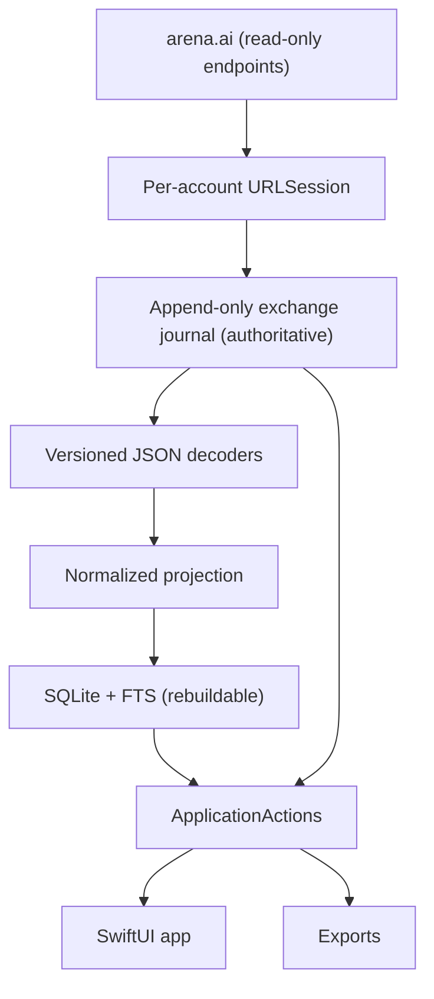

# Arena Suite — Implementation Plan v3

Revised 24 September 2026 • **Supersedes `Arena-Suite-Master-Plan-v2.md`** (kept unchanged for history).

v2 was written before any live Arena session existed. v3 rebuilds the plan around what Phase 0 actually found:

- Native email/password sign-in, identity verification, Keychain session restoration, and native history listing **work** (N-002/N-003, N-005/N-006).
- Native generation **does not**: the create request needs a reCAPTCHA v3 token, and the public client's null-token fallback was rejected with HTTP 403 `recaptcha validation failed` (N-004).

v2 treated Phase 0 as all-or-nothing and said nothing about a partial result. v3 makes the partial result the product:

> **v1 is a native, read-only Arena archiver.** It signs in natively, imports conversation history into a durable local evidence journal, and lets you browse, search, and export it. Conversations still happen on arena.ai; Arena Suite archives them.
>
> **Native generation is a separate, conditional track (Track B).** It starts only if a legitimate, native-compatible access path is found. It is not on the v1 critical path.

## 0. What changed from v2, and why

| Area | v2 | v3 | Reason |
|---|---|---|---|
| Product definition | Full native chat client + archive + MCP + datasets | Read-only native archiver; generation conditional | Generation is blocked by reCAPTCHA v3; read-only access is proven |
| Phase 0 outcome | Pass/fail on one complete conversation flow | Two gates: **A** read-only (nearly passed), **B** generation (blocked) | Partial feasibility needed a defined outcome |
| Terms/account risk | Not discussed | Explicit section and gate (§2) | The whole product depends on a private, undocumented API |
| Voting/reveal | Separate MCP grants | Manual, user-clicked only, inside Track B; never automated or exposed to MCP | They affect a public leaderboard and are the most likely anti-abuse trigger |
| Bulk generation | Separate MCP grant | **Removed from scope** | Quota and anti-abuse risk with no archiver value |
| Model-attribution datasets, timing fingerprints | First-class architecture | Deferred; capture keeps the data needed to do this later | Not needed for an archiver; large design cost |
| Stream parsing | WHATWG SSE-first | JSON history decoding in v1; the observed prefixed-line dialect (`a0:`/`a2:`/`ad:`) only in Track B | Arena's stream is labeled `text/event-stream` but isn't standard SSE |
| Journal | Callback-level stream journal with hash chain, watermarks, clock sessions | Same principles, sized to whole HTTP exchanges; callback detail reserved for Track B | v1 traffic is request/response JSON, not long streams |
| MCP | Full application control, IPC, enrollment, 30 capabilities | Optional read-only MCP after v1 | Nothing in v1 needs it |
| Exports | Raw, Normalized, Markdown, Training JSONL | Raw, Normalized, Markdown | Training export deferred with datasets |
| Stress gate | 8 × 1 MiB/s streams for 10 min | Sized to measured history volumes | Match real traffic |
| Process | Reviewer after every slice | Reviewer at phase boundaries and for auth/persistence changes | Several reviews were lost to usage limits; the reviewer never had a working shell |

What v3 keeps from v2 unchanged in spirit: record before interpret, the raw journal as the authority, SQLite as a rebuildable projection, opaque scoped remote IDs, message graphs rather than flat lists, conflicting claims preserved with provenance, explicit missingness, account context frozen per operation, no browser runtime in the product, and no CAPTCHA/anti-abuse bypass.

## 1. Product scope

### v1 (Track A): native read-only archiver

1. Sign in natively with email/password (observed contract). Store session material in Keychain per account; restore it on launch; verify server identity before any other request.
2. Sync history: list pages, fetch conversation details, record every response exactly before interpreting it.
3. Keep an append-only local journal as the authoritative evidence store, and a rebuildable SQLite index for browsing and search.
4. Native macOS UI: accounts, conversation list, transcript view (lanes/branches as exposed), full-text search, a raw-evidence inspector, sync status and warnings.
5. Exports: Raw JSON, Normalized JSON, Markdown.
6. Works fully offline for browsing once synced.
7. Multiple accounts are supported but each is independent; there is no cross-account feature.

### Explicitly out of v1

- Sending prompts, continuing, stopping, regenerating, voting, revealing models, uploading files.
- Any browser runtime: no WebView, no embedded browser, no browser-token transfer, no page scripts. (Browser DevTools remain allowed as a research instrument outside the product, as in Phase 0.)
  - **Amended 2026-10-18 by the user (ADR 0006):** one exception, arena.ai shown visibly inside the app's main window (first a separate window; moved into the main window the same day at the user's request), driven by the user, with one web profile per account. It runs no injected scripts, reads no page, cookie or storage data, transfers no tokens, opens no web view the user did not open, and stays outside the journal. Conversations made there reach the archive only through the native history sync. Native generation (Track B, below) is unchanged.
- MCP, training datasets, timing fingerprinting, model-attribution features.
- File/workspace downloads, unless Phase 0-A finds exposed file resources in history detail (then see §9.4).

### Track B (conditional): native generation

Starts only when **all** of the following hold:

1. A legitimate native-compatible generation path exists. Acceptable examples: an official Arena API or developer access; an Arena-supported non-browser challenge or attestation; explicit permission from Arena. Not acceptable: copying browser tokens, running reCAPTCHA in a hidden WebView, solving or farming challenges, replaying captured tokens.
2. The user decides to proceed after reviewing §2.
3. Track A phases 1–4 are done (the journal and index exist to receive live traffic).

If Track B starts, v2 §§4, 8, 15 (callback-level capture, timing, concurrency) are the starting reference and get re-planned then.

**Manual voting and reveal (Track B only).** Voting is a write action like sending a prompt and is assumed to face the same challenge until observed otherwise (NEEDS PROTOCOL VERIFICATION: vote/reveal routes, whether they require a reCAPTCHA token, and how reveal relates to the vote). If Track B's conditions are met and the vote/reveal contract is observed, the app may offer:

- a **Vote** control on a battle the user just ran in the app, sent only by an explicit click, one request, no retry;
- **Reveal** of model identities after the vote, as a user click;
- the revealed identities recorded as `arena_reported` model claims scoped to that battle's lanes.

Hard limits, not settings: no vote or reveal from MCP, scripts, schedules, or any other automation; no pre-selected or suggested vote; no batch voting; no voting on conversations imported from history; model-identity features, timing, or fingerprints are never used to suggest or influence a vote. Every vote/reveal record carries `origin=ui` and the account context. Until then, the capability matrix reports `sendPrompt`/`createConversation` as **`unsupported` (blocked: reCAPTCHA v3, N-004)** rather than `unknown`.

## 2. Terms of service, account risk, and traffic policy

Arena Suite talks to a private, undocumented consumer API. That is the project's largest non-technical risk, and v2 did not address it.

**Gate R (before Phase 1):** the user reads Arena's current terms of use and records in `Docs/ADR/0005-product-scope.md` (a) whether a third-party client that reads the user's own history is acceptable to them in light of those terms, and (b) the accepted risk (e.g. account suspension). The agent does not interpret the terms on the user's behalf and does not claim they permit anything.

Traffic policy for all versions (design decisions, enforced in the adapter):

- **User-initiated sync only by default.** No automatic network activity at launch beyond identity verification of an already-saved session; history sync is a button or an opt-in schedule no more frequent than hourly.
- **Low, fixed concurrency:** one in-flight request per account; a minimum delay between detail requests (start at 1 s, configurable upward only).
- Honor `Retry-After` and 429/503; back off exponentially; stop the sync job after repeated failures rather than retrying indefinitely.
- Incremental sync: stop listing when already-archived, unchanged conversations are reached (see §9.3).
- Never use multiple accounts to work around limits. Never automate account creation.
- Identify nothing false: do not spoof a browser user agent or TLS fingerprint. Foundation's defaults are used as-is.
- Any 403 or challenge response on a read endpoint stops the job, is recorded, and surfaces as `interaction_required`/`blocked`. No retry loop.
- *Scope note, 2026-10-18 (ADR 0006):* this policy governs the app's native requests. The embedded arena.ai page the user opens is the site's own browser traffic, including while its session is kept in the background. The app does not originate, rate-limit, observe or record it, and it cannot detect a 403 or challenge there; Arena's own page handles those.

Privacy: the archive holds private conversations. Store it under Application Support with `0700` permissions; document that at-rest protection relies on FileVault. Diagnostics and logs never contain conversation text, cookies, or identity values.

## 3. Evidence so far (Phase 0 results)

Evidence vocabulary is unchanged: `verified_observation`, `repository_evidence`, `design_decision`, `assumption`, `NEEDS PROTOCOL VERIFICATION`. The ledger (`Docs/protocol-ledger.md`) remains the record; this table only summarizes it.

| Operation | Observed contract (summary) | Native status |
|---|---|---|
| Sign-in | POST `/nextjs-api/sign-in/email`, JSON `{email, password, shouldLinkHistory}`; sets session cookies | **Verified** once (N-002); one earlier unexplained 401 (N-001) |
| Identity | GET `/api/me` → `user.id`, `user.supabaseUserId`, `user.email` | **Verified** (N-002/N-003); returned email may differ in formatting from input — compare IDs, never emails |
| Session restore | Keychain-saved cookies → `/api/me` IDs match | **Verified** same-build relaunch (N-006); cross-build without prompts once the item is created by an identity-signed build (N-009) |
| History list | GET `/api/history/unified?limit=N&includeArchived=…[&cursor=…]` → `entries`, `pagination{hasMore,cursor,limit}`, `partial`, `failedSources` | **Verified** incl. cursor pagination (N-005, N-008) |
| History detail | GET `/api/evaluation/{id}` → `id`, `title`, `mode`, `visibility`, `lastMessageIds`, `archivedAt`, `deletedAt`, `messages[]` (with `id`, `role`, `status`, `parentMessageIds`, `evaluationSessionId`, attachments) | **Verified** natively (N-007, N-008); `messages[].metadata` holds per-user anti-abuse telemetry (N-008); fixture `native-detail.fixture.json` |
| Create / follow-up | POST `/nextjs-api/stream/create-evaluation`, POST `/nextjs-api/stream/post-to-evaluation/{id}`; body includes `recaptchaV3Token`; response is prefixed lines (`a0` text, `a2` arrays, `ad` finish) | Browser-observed (C-001/C-002); **native blocked** (N-004, 403) |
| Refresh / expiry | Auth cookies `arena-auth-prod-v1.0/1.1`, ~13-month expiry, re-issued on some request (not `/api/me`); no session → `/api/me` 401 JSON | Partly observed (N-008); ≥24 h behaviour pending |
| Two accounts | Separate URLSession configurations/jars in one process | **Verified** (N-010): distinct principals, 0 shared entries or cookie values |
| Other types in history | `agentic` entries (no `mode`/`modality`) | Observed in list (N-008); detail route not observed — archived list-only |

Transport: Foundation `URLSession` is **accepted for Track A**. Its known limits (decoded gzip, merged duplicate headers, no trailers — `Docs/transport-results.md`) do not matter for JSON history responses. Record them as declared observation-boundary limits. Re-evaluate only for Track B.

## 4. Remaining Phase 0-A (read-only gate)

Phase 0-A passes when each item below has a recorded observation, or a documented limitation that v1 accepts. All run in the disposable `Tools/NativeAuthProof`, not the product.

| # | Experiment | Pass condition |
|---|---|---|
| A1 | Native detail GET (probe already built and reviewed) | HTTP 200; detail ID matches list ID; message session IDs match; parent references resolve |
| A2 | Pagination | Observe a non-null `cursor` with `hasMore=true` (use the observed `limit` parameter with a smaller value, labeled as an experiment) and fetch page 2 using exactly the returned cursor. Record the cursor parameter name only from evidence (browser or public client source); do not guess it |
| A3 | Other history entry types | Record which `type` values appear and whether each has an observed detail route. Unknown types are archived as list entries only |
| A4 | Session lifetime | Record cookie expiry attributes (names/expiry only, no values); observe what happens to a restored session after a day or more; observe whether any response rotates cookies |
| A5 | Expired/invalid session | Native request with a deliberately forgotten/invalidated session returns an observable status (e.g. 401) and the proof reports "sign in again" rather than retrying |
| A6 | Cross-build restore | Sign the proof with a stable Apple Development identity (not ad-hoc) and confirm Keychain restore survives a rebuild. If only ad-hoc signing is available, document a re-login after each rebuild as an accepted development limitation |
| A7 | Two-account isolation (only if the user has a second account they are willing to use) | Two proof sessions, each identity-verified, histories disjoint by account; restoring A never returns B's identity. If skipped, v1 ships single-account and A7 moves to Phase 2 |
| A8 | Detail fixture | One sanitized, transformation-declared detail fixture checked in; private exact capture kept outside Git |

Record the decision in `Docs/ADR/0005-product-scope.md`: Phase 0-A result, Gate R outcome, Track B status (blocked, evidence N-004).

## 5. Architecture

One macOS app process. No daemon, helper process, IPC, or browser runtime.



Invariants (condensed from v2, still binding):

1. **Record before interpret.** Every response body is journaled exactly as delivered by Foundation before any decoding.
2. **The journal is authoritative; SQLite is disposable.** Deleting the index and replaying the journal reproduces the same archive.
3. **Unknown data survives.** Unknown fields, entry types and message shapes remain in raw evidence and are counted as warnings, never dropped or coerced.
4. **Conflicting observations coexist.** A later snapshot of a conversation does not overwrite an earlier one; both are evidence.
5. **Account context is immutable per operation.** A sync job is bound to one account; switching the UI selection never redirects it.
6. **Identity is verified by server IDs**, before every job and after every restore. A mismatch quarantines the session.
7. **Credentials are a declared exception.** Passwords are never stored; cookies live only in Keychain; ordinary evidence records credential *omission*, never values.
8. **Remote IDs are opaque**, scoped by account and entity kind; no UUID-syntax assumptions.
9. **Model identity claims keep their source.** `modelAId`/`modelBId` from a history list are `history_reported` claims; they are not upgraded to verified identity.
10. **Protocol drift degrades safely.** A decoder failure marks the snapshot `parse_failed` with the raw bytes retained; sync continues for other conversations.
11. **UI goes through ApplicationActions.** Views never touch URLSession, the journal, or GRDB directly. (This keeps an MCP or CLI surface cheap to add later without a second implementation.)

## 6. Technology

| Area | Choice |
|---|---|
| Platform | macOS 14+, ARM64 only, Swift 6 language mode, full Xcode (current host: Xcode 27, Swift 6.4) |
| UI | SwiftUI + Observation; AppKit bridges only for large selectable text |
| HTTP | Foundation `URLSession`, one ephemeral configuration per account, `urlCache`/`urlCredentialStorage` nil, redirects refused unless same-origin and observed |
| Credentials | Keychain generic-password item per account; stable code-signing identity so items survive rebuilds |
| Journal | Small binary record format with POSIX I/O (§7) |
| Index | SQLite via GRDB 7.11.1 (pinned and build-tested in Phase 0), WAL, FTS5 |
| Hashing | CryptoKit SHA-256 |
| Tests | Swift Testing; loopback fixture server; subprocess kill harness for the journal |

No other third-party dependencies in v1. The MCP SDK pin (0.12.1) stays in the dependency probe only.

## 7. The exchange journal

v1 records **HTTP exchanges**, not stream callbacks. One sync request produces one exchange record.

### Record contents

- Envelope (UTF-8 JSON, bounded size): `record_id`, `account_id`, `job_id`, `sequence`, `kind` (`exchange`, `job.started`, `job.finished`, `session.verified`, `session.quarantined`, `local.control`), method, redacted route template + actual path with IDs, query, request header names, response status, response headers as delivered, content type, `observed_at_utc`, monotonic ticks at request start and response end, transfer end state (`complete`/`interrupted`/`capture_limit`), `credential_omitted` transformation, adapter version.
- Payload: exact response body bytes as delivered by Foundation (declared layer: `foundation_decoded_entity`).
- Trailer: SHA-256 over the stored envelope and payload bytes.

### Format and durability

- File `ASJ1`: magic, fixed-width little-endian lengths (envelope, payload), envelope, payload, digest. All lengths validated with overflow checks; envelope capped (e.g. 64 KiB); payload capped (e.g. 32 MiB) with `capture_limit` recorded if exceeded.
- One journal per account, segments rotated at ~64 MiB; a sealed segment has a manifest with its digest and first/last sequence.
- Writes: complete all partial writes, then `fsync` after each job-level batch and on job completion. An exchange is **acknowledged** only after it is appended; the decoder and index only read acknowledged records.
- Recovery on launch: keep every valid record; copy a torn tail to `recovery/quarantined/` before truncating the active segment; never skip corruption in the middle of a sealed segment silently. A job with no `job.finished` record becomes `interrupted`.
- Local user state that must survive an index rebuild (tags, hidden conversations, per-account settings) is written as `local.control` records.
- Specify exact byte layout in `Docs/journal-format-v1.md` with a golden binary fixture **before** the writer is implemented.

Dropped from v2 for v1: per-callback records, hash chaining across records, clock-session anchors, four-level watermarks. Per-record digests plus sealed-segment manifests are enough to detect damage. Track B can add callback-level records as a new record kind without changing the container.

## 8. Data model

Scoped to what history exposes. Every entity keeps a provenance reference (record ID + JSON pointer).

| Entity | Meaning |
|---|---|
| Account | Local UUID, display name, verified principal IDs (`id`, `supabaseUserId`), Keychain reference, auth state |
| Conversation | Local ID, account, remote ID + entity type (e.g. `evaluation`), mode, modality, visibility, archived/deleted observations |
| Snapshot | One retrieval of a conversation's detail (record ID, retrieved time, content hash). Conversations have many snapshots |
| Message | Remote ID, role, status, snapshot, content blocks, raw reference |
| MessageEdge | Parent → child from `parentMessageIds`; missing ancestors kept as unresolved nodes |
| Lane | Response lane (e.g. model A / model B) when exposed; more than two supported |
| ContentBlock | Ordered text/code/reasoning/tool/attachment/opaque blocks as exposed; unknown kinds stay opaque |
| ModelClaim | Claim value, role (`modelA`, `modelB`, …), source (`history_list`, `history_detail`, …), record reference. Conflicts retained |
| Attachment | Metadata as exposed; bytes only if §9.4 applies |
| Warning | Unknown field/type, parse failure, partial page, missing ancestor, failed source |

Value states: `known`, `not_exposed`, `parse_failed`, `redacted`, `unknown`. Empty strings and `false` are known values.

"Complete" always names its scope, e.g. "history synced through observed pagination on 2026-09-30", never "complete conversation".

## 9. History sync

### 9.1 Job

A `HistorySyncJob` binds one account and runs:

1. Verify identity (`/api/me`, both IDs match the account). Mismatch → quarantine, stop.
2. Fetch list pages, journal each, decode entries, follow only the server-supplied cursor.
3. For each entry needing a snapshot (§9.3), fetch detail via the observed route for that entry type, journal it, decode it.
4. Checkpoint after each page and each detail (job ID + last completed record sequence), so the job resumes after interruption without refetching completed work.
5. Finish with a manifest: pages, entries, details fetched/skipped/failed, cursor evidence, exhaustion evidence (`hasMore=false`), and warnings.

### 9.2 Pagination safety

Stop with `partial` status on: a repeated cursor, a repeated page hash, `hasMore=true` with no cursor, `partial=true` or non-empty `failedSources` (record them, keep going only if the page decoded), or any 4xx/5xx. Label results "completed observed pagination", never "complete history".

### 9.3 Incremental sync

Refetch a conversation's detail only when its list entry is new or its `updatedAt` differs from the last snapshot's source value. Listing stops early once a full page consists of unchanged, already-archived entries (configurable; a periodic full pass is available manually). This keeps traffic proportional to new activity (§2).

### 9.4 Files

If A1/A3 show attachments with resolvable resource URLs, add download to v1: one download at a time, hash-verified, stored content-addressed under `objects/sha256/`, with expired/denied/unavailable states. Otherwise record attachment metadata only and defer downloads.

### 9.5 Deletion and absence

A conversation missing from a later listing, or a 404 on detail, is recorded as an observation. It never deletes local evidence. Local deletion is a separate, explicit user action (hide first; purge is a later maintenance feature).

## 10. Decoding and projection

- One versioned decoder per observed response shape: `/api/me`, history list page, evaluation detail. Decoders read journal records and produce neutral events with raw references; they never write SQL.
- Unknown fields are tracked by JSON pointer with counts and first/last record references.
- Large integers and duplicate keys stay in raw bytes; the decoder must not claim exactness for values it coerced.
- Projection (reducer) is deterministic and replayable: same journal + same decoder version → same entity IDs and content hashes. Stable IDs are derived from account + remote ID + entity kind, never random per replay.
- SQLite (GRDB, WAL, foreign keys on): tables for accounts, jobs, records (location index), conversations, snapshots, messages, edges, blocks, model_claims, warnings, tags, and an FTS5 table over message text. Each projection generation is tagged with decoder versions and the journal high-water mark it covers; checkpoints commit in the same transaction as their rows.
- Rebuild = delete index, replay journal. This is a tested release gate.

## 11. Native UI

- **Sidebar:** account switcher with auth state; conversation list (title, date, mode, model claims with source, snapshot count, warnings).
- **Transcript:** messages rendered from the selected snapshot; branches and lanes shown as exposed, never merged; a snapshot picker when several exist.
- **Search:** FTS over message text with account/mode/date filters.
- **Inspector:** raw record viewer (headers, bytes as text/hex, hash), decoder version, unknown fields, provenance of each displayed field.
- **Sync:** per-account Sync button, progress, last result manifest, and a clear stop state for challenges/auth failures ("Sign in again", "Arena blocked this request").
- **Sign-in:** native email/password sheet; the password is sent once and never stored.
- Standard macOS behavior: keyboard navigation, VoiceOver labels, Command-F, selectable text, system appearance.

## 12. Exports

| Format | Contract |
|---|---|
| Raw JSON | Selected records: envelopes, base64 payloads, hashes, declared observation layer and credential omissions |
| Normalized JSON | Versioned entities and edges with provenance and value states |
| Markdown | Human-readable transcript per branch/lane, with a capture-scope footer; explicitly lossy |

**Telemetry in detail responses (N-008).** `messages[].metadata` contains per-user anti-abuse data (bot/reCAPTCHA scores, JA4 fingerprint ratios, Cloudflare geo fields and hashed IP, activity and vote counts) and routing/usage data. It is the user's own data and stays in the journal, but Normalized JSON and Markdown exclude `metadata` subtrees by default (opt-in per export), Raw JSON marks records containing them as sensitive, and diagnostics never include them. Any fixture must mask them.

Exports read a frozen snapshot (journal high-water + projection generation), write to a staging file, then move atomically into Downloads or a chosen folder; no silent overwrite. Repeated exports of the same frozen input produce identical bytes.

Training JSONL and dataset recipes are deferred (§14). Because the journal keeps model claims with their sources, and lanes/branches separately, they can be built later without re-capturing.

## 13. Phases

Each phase has one definition of done. Reviewer runs at the end of a phase and on any change touching credentials, Keychain, journal format, or recovery.

| Phase | Deliverable | Definition of done |
|---|---|---|
| **0-A** Close read-only feasibility | §4 experiments A1–A8; ADR-0005; Gate R | Every A-item observed or accepted as a documented limitation; user decision recorded |
| **1** Journal | `journal-format-v1.md`, golden fixture, writer, reader, verifier, tail recovery | Subprocess kill at every write boundary loses no acknowledged record; torn tails quarantined; ENOSPC/EIO surface as blocking errors |
| **2** Accounts & sessions | Keychain credential store, per-account URLSession, sign-in, restore, identity verification, expiry → re-auth | Two accounts (or one, per A7) persist across relaunch and rebuild; mismatch quarantines; no request is sent before identity verification |
| **3** History sync | Recorded read-only transport, list/detail client for observed routes, resumable job, incremental sync, traffic policy | Sync of the user's real history completes with a manifest; interrupting and resuming refetches nothing already committed; 403/429 stop the job cleanly |
| **4** Decoding & index | Decoders, reducer, GRDB schema, FTS, projection generations | Deleting the index and replaying reproduces identical entity IDs and content hashes; unknown fields are counted, not lost |
| **5** Native UI | Sidebar, transcript, search, inspector, sync, sign-in | All synced conversations browsable and searchable offline; raw evidence reachable from any displayed message |
| **6** Exports | Raw/Normalized/Markdown | Deterministic output for frozen inputs; staging + atomic move; cancellation leaves nothing partial |
| **7** Hardening & personal release | Verify job, backup (copy sealed segments + manifest), diagnostics bundle without content, packaging | Clean install and upgrade on the target Mac; backup restores to an equal archive; release notes list known limits |

Test sizing: generate synthetic histories 10× the user's measured history size (entries and bytes, measured in Phase 3) and require sync, replay and search to stay within recorded time and memory budgets. No synthetic multi-stream stress gate in v1.

## 14. Later, optional

Each needs its own go decision; none is implied by v1.

- **Read-only MCP.** Search, get conversation, export — through the existing ApplicationActions. No Arena network actions, no voting or reveal, no bulk operations.
- **Training/attribution datasets.** Built from the journal with v2 §12's hygiene rules (label evidence tiers, grouping before splits, leakage audit). No automated voting or reveal, and no use of fingerprints or model-identity features to influence voting (see §1, manual voting).
- **Track B generation.** Only under §1's conditions; re-plan capture, timing and concurrency then.
- **Maintenance.** Selective purge with journal rewrite, reparse promotion/rollback, tiered verification.

## 15. Failure behavior (v1)

| Failure | Behavior |
|---|---|
| Session expired / 401 | Stop the job, mark account "sign in again", keep all evidence; no automatic credential retry |
| Identity mismatch | Quarantine the session, stop, show mismatch; nothing written under the wrong account |
| 403 / challenge / unexpected HTML | Record the exchange, stop the job, show "blocked by Arena"; no retry loop |
| 429 / 503 | Honor `Retry-After`, exponential backoff, bounded attempts, then stop with partial status |
| New fields / unknown entry types | Keep raw, count warnings, project known parts |
| Decoder failure | Snapshot `parse_failed`, raw retained, continue other conversations |
| Cursor loop / moving list | Stop with partial status and cursor evidence |
| App crash mid-sync | Recover valid journal prefix; job becomes `interrupted`; resume from checkpoint |
| Disk full / I/O error | Stop sync, block new jobs, show persistent error; never report unsaved data as archived |
| Corrupt index | Rebuild from journal |
| Corrupt sealed segment | Quarantine, report affected conversations, restore from backup if present |
| Remote deletion / 404 | Record absence; keep local evidence |

## 16. Repository structure (target)

Keep what exists; add only what the current phase needs.

```text
App/                                  SwiftUI app (Phase 5)
Packages/ArenaSuiteCore/Sources/
  SuiteDomain/                        IDs, AccountContext, Evidence, value states
  CaptureJournal/                     Phase 1
  ArchiveProjection/                  Phase 4 (reducer)
  ArchiveIndex/                       Phase 4 (GRDB)
  Export/                             Phase 6
  ApplicationActions/                 grows each phase
Packages/ArenaProtocol/Sources/
  ArenaAdapter/                       only module allowed to know Arena routes
    Authentication/  History/  Decoders/  Capabilities/
  FoundationTransport/                recorded per-account sessions
Tools/NativeAuthProof/                disposable Phase 0 research; never linked into the app
Tools/FixtureHarness/  Tools/CrashHarness/ (Phase 1)
Fixtures/  Docs/  Scripts/  Config/
```

`Scripts/check-boundaries.py` enforces: only `ArenaAdapter` contains Arena routes; the app imports only `ApplicationActions`/DTOs; `CaptureJournal` knows nothing about Arena schemas; nothing imports `Tools/NativeAuthProof`.

## 17. Working process for coding agents

- Work one phase at a time; state acceptance criteria before editing; run `Scripts/test-offline.sh` after each coherent change.
- Reviewer subagent: at phase end, and for credential/Keychain/journal-format/recovery changes. The reviewer runs **one shell command per call** (no `;`/`&&` chains) so its allow-list permits it, and must say whether it saw the actual diff and ran tests.
- Live experiments against Arena: announce each one first, one request at a time, no retries without the user's say-so, results recorded in the ledger.
- Commits: small and descriptive, with the user's configured Git identity. Push only when the user asks.
- Docs: one current-status table in `Docs/phase-0.md` (and later a per-phase status file) instead of stacked dated updates; historical observations stay in their dated observation files.

## 18. Open questions

| Question | Where answered |
|---|---|
| Cursor parameter name and cursor stability | A2 |
| Non-`evaluation` history types and their detail routes | A3 |
| Session lifetime, rotation, refresh endpoint (if any) | A4/A5 |
| Whether history exposes reasoning, tool output, file resources | A1/A3 |
| Whether `updatedAt` reliably changes on new messages (incremental sync correctness) | Phase 3, by comparing a known conversation before/after a browser follow-up |
| Rate limits on read endpoints | Phase 3, from normal traffic only; never by exhausting quota |
| Whether Arena offers any official API or access path for generation | User inquiry; gates Track B |
